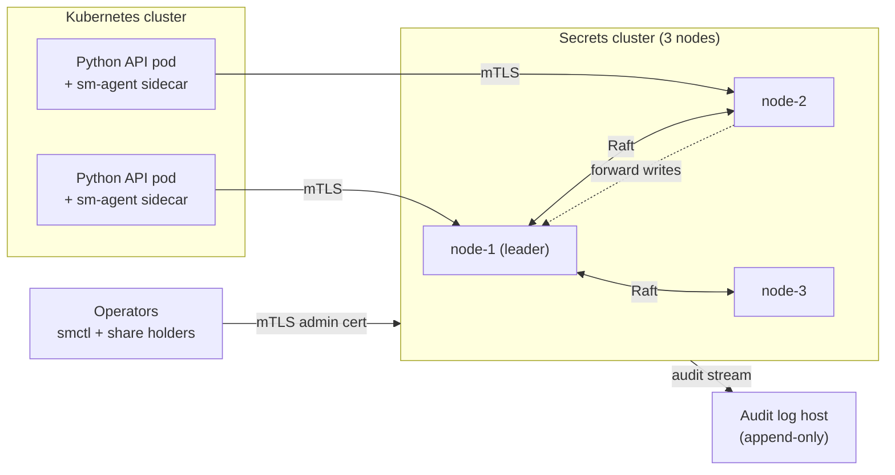
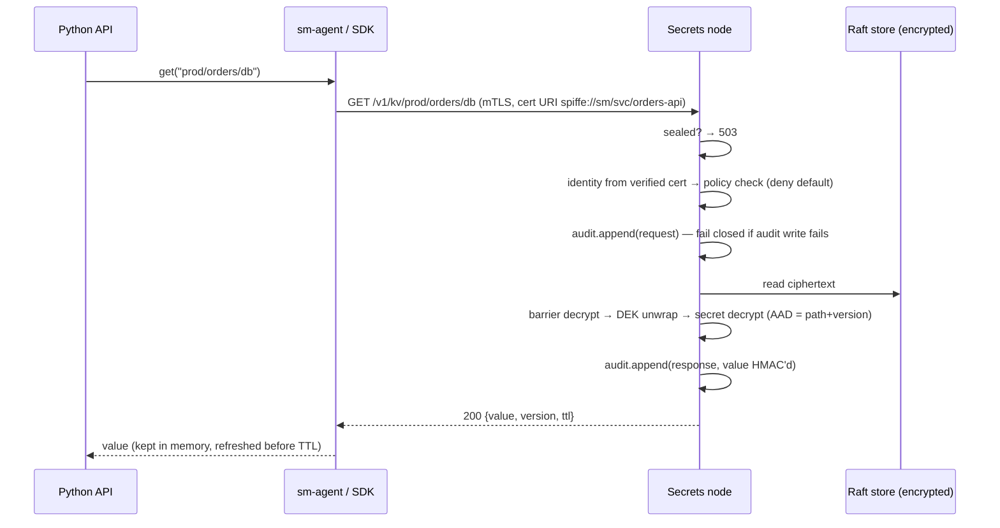
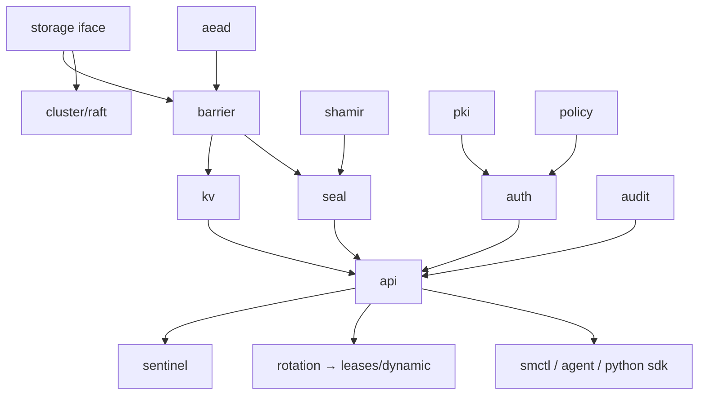

# Self-Hosted Secrets Manager — Implementation Plan

As of 2026-09-23

## 1. Overview

We will build a self-hosted secrets manager in Go. It runs as a 3-node HA cluster from day one, unlocks with Shamir key shares, and serves secrets to Python APIs on Docker/Kubernetes over mTLS. Work is split into 14 iterations. Iterations with no dependencies come first (pure libraries), and the ones that depend on them come later (integration, delivery, hardening).

### Hard constraints

- **No third-party services**: no AWS, GCP, Azure, cloud KMS, managed databases or SaaS CI. Only open-source libraries and our own code, running on our own machines.
- **No custom cryptographic algorithms.** We combine vetted primitives from Go's standard library and `golang.org/x/crypto`. Only the glue code is custom.
- **Fail closed.** If a node is sealed, the audit log can't be written or no policy matches, the request is denied.
- **No plaintext secrets at rest or in logs**, on the server or the client.

### In scope for 1.0

- Versioned key-value secrets with staging labels (`current` / `previous` / `pending`)
- Envelope encryption under a master key that exists only in RAM after unseal
- Shamir init/unseal ceremony and rekey
- Internal certificate authority and mTLS service identity
- Path-based, deny-by-default policies
- Hash-chained, tamper-evident audit log
- Scheduled zero-downtime rotation, and dynamic (leased) database credentials
- Operator CLI (`smctl`), Kubernetes agent (init container and sidecar), Python SDK
- Encrypted snapshots and backups, metrics, health checks
- Optional anomaly detection on access patterns

### Out of scope for 1.0

- Web UI (CLI only)
- Multi-tenancy and namespaces
- Cross-datacenter replication
- Client SDKs other than Python

---

## 2. Tech stack

Every item below is either open-source code compiled into our binaries or software we host ourselves.

| Area | Choice | Why |
|---|---|---|
| Server language | Go (latest stable, currently ≥ 1.24) | Standard library covers crypto, TLS, x509 and HTTP/2; ships as one static binary; used by Vault, OpenBao and etcd |
| Consensus / HA | `hashicorp/raft` (MPL-2.0) library | Proven Raft implementation that runs inside our binary, with no external service |
| Raft log + state storage | `hashicorp/raft-boltdb/v2` + `go.etcd.io/bbolt` | Embedded storage on each node's local disk, so no separate database to run |
| Symmetric encryption | `x/crypto/chacha20poly1305` (XChaCha20-Poly1305) for both data and key wrapping | One audited AEAD; its 24-byte random nonces are safe without nonce counters, so a second cipher adds nothing |
| Key derivation | `crypto/hkdf` (stdlib), `x/crypto/argon2` (only for passphrase-protected exports) | Standard |
| Randomness | `crypto/rand` only | Never `math/rand` |
| Shamir secret sharing | Port of OpenBao's `shamir` package (MPL-2.0, GF(2^8)), with our own tests | Small, well-reviewed code; safer than writing it from scratch |
| Share delivery at init | `filippo.io/age` (optional) | Each share is encrypted to one admin's age public key, so no one sees another admin's share |
| Protecting secrets in memory | `github.com/awnumar/memguard` | Locked pages and zeroing on free, for the master key and keyring |
| Transport | `crypto/tls` (TLS 1.3 only), `net/http` HTTP/2, JSON | mTLS without extra frameworks; easy to call from Python |
| Internal CA | Our own `pki` module on `crypto/x509` | Issues short-lived certificates with SPIFFE-style URI SANs |
| Rate limiting | `golang.org/x/time/rate` | Token bucket per identity |
| CLI | Standard library `flag` + `golang.org/x/term` (no-echo prompts) | About 20 subcommands need no framework; fewer dependencies in the tool that holds admin credentials |
| Logging | `log/slog` (stdlib) | Structured logs; secret fields are redacted by type |
| Metrics | `prometheus/client_golang`, with Prometheus + Grafana self-hosted | Open source, runs on our own servers |
| Kubernetes integration | One HTTPS call to TokenReview (standard library) | Verifies pod service-account tokens against **your own** cluster API; `client-go` would add dozens of packages for one request |
| Python SDK | Python ≥ 3.10, standard library only (`ssl`, `urllib`, `threading`) | Zero dependencies for the APIs that embed it |
| Anomaly detection | Python ≥ 3.11, standard library only (Stage A rules); `scikit-learn` IsolationForest only if Stage B is ever needed | Rules are enough until real traffic says otherwise; see §6 |
| Testing | `go test`, native Go fuzzing, `pytest`, `kind` (local K8s), `toxiproxy` (network faults) | All run locally |
| Static analysis | `staticcheck`, `gosec`, `govulncheck`, `go vet` | Run in CI on every commit |
| CI and source control | Self-hosted Forgejo + Forgejo Actions runners (or Woodpecker CI) | No SaaS CI |
| Container images | `FROM scratch` + static binary; images built locally and pushed to a self-hosted registry (Forgejo's built-in or `distribution/registry`) | No external base images or registries at runtime |
| Dependency hygiene | `go mod vendor` committed; checksums verified; Renovate self-hosted (optional) | Builds are reproducible and don't need network access |

---

## 3. Architecture and modules

### 3.1 Runtime topology

- Each node stores the Raft log and state in bbolt on local disk. Everything above the storage layer is encrypted by the **barrier** before it reaches Raft, so disks, snapshots and Raft traffic contain only ciphertext.
- Every node starts **sealed** and must be unsealed on its own with M of N Shamir shares.
- Followers forward both writes and reads to the leader over an mTLS cluster RPC port. The leader serves reads after `VerifyLeader`, so every read is linearizable. (Serving reads on followers is a later optimisation if the leader becomes a bottleneck; clients cache anyway.)

### 3.2 Request lifecycle (read a secret)

### 3.3 Modules (Go packages in one repository)

| # | Module | Responsibility | Depends on |
|---|---|---|---|
| M1 | `internal/crypto/aead` | Generate DEKs; encrypt/decrypt with AAD; key and ciphertext versioning; zeroing | stdlib only |
| M2 | `internal/crypto/shamir` | Split/combine a 32-byte key into N shares with threshold M | stdlib only |
| M3 | `internal/audit` | Hash-chained entries (`hash_n = SHA-256(hash_{n-1} ‖ entry)`), HMAC of sensitive fields, file/TCP sinks, chain verifier | stdlib only |
| M4 | `internal/policy` | Parse JSON policies; path glob matching; capabilities (`read`, `list`, `create`, `update`, `delete`, `rotate`); deny-by-default evaluation; admin actions are capabilities on `sys/...` paths | stdlib only |
| M5 | `internal/pki` | Root CA (offline), intermediate CA, certificate issuance with URI SANs, short TTLs, identity parsing from certificates | stdlib only |
| M6 | `internal/storage` | `Backend` interface (Get/Put/Delete/List/Txn); in-memory implementation for tests | none |
| M7 | `internal/cluster` | Raft FSM over bbolt, bootstrap/join/remove, write forwarding to the leader, snapshots, linearizable reads | M6, hashicorp/raft |
| M8 | `internal/barrier` (barrier.go, keyset.go) | Keyring (versioned encryption keys, "terms"); encrypts every storage value; root key wraps the keyring | M1, M6 |
| M9 | `internal/barrier` (seal.go) | Sealed/unsealed state machine, init ceremony, share collection with timeout, rekey, seal-now. Same package as M8: they share private key-handling code | M2, M8 |
| M10 | `internal/auth` | mTLS identity extraction, admin identities, single-use enrollment tokens, Kubernetes TokenReview login → certificate issuance | M4, M5, M8 |
| M11 | `internal/kv` | Versioned secrets, staging labels, metadata, soft delete with 7–30 day recovery window, check-and-set | M8 |
| M12 | `internal/api` | HTTP/2 server, routing, request pipeline (seal → auth → policy → audit → handler), rate limits, `/health`, `/metrics` | M3, M4, M9, M10, M11 |
| M13 | `cmd/smctl` | Operator CLI: init, unseal, status, rekey, policy, kv, cert, audit verify, snapshot | M12 API |
| M14 | `cmd/sm-agent` | Init container + sidecar: login, fetch, render to tmpfs files, refresh, renew certificate, signal app | M12 API |
| M15 | `sdk/python` (`smclient`) | mTLS client, in-memory TTL cache, background refresh, serve-stale-on-error, typed errors | M12 API |
| M16 | `internal/rotation` | Leader-only scheduler; 4-step rotation state machine (create → set → test → finish); plugin interface; built-in plugins | M11, M7 |
| M17 | `internal/lease` + `internal/dynamic` | Leases with TTL/renew/revoke; dynamic PostgreSQL/MySQL users per client | M16, M11 |
| M18 | `internal/ops` | Encrypted snapshot backup/restore, audit forwarding, dead-node cleanup, upgrade checks | M7, M8, M3 |
| M19 | `sentinel/` (Python, optional) | Reads a copy of the audit stream; rules + IsolationForest; alerts only | M3 output format |

### 3.4 Dependency graph

M1–M6 depend on nothing, so they can be built in parallel and tested in isolation.

---

## 4. Features

Priority: **Must** = required for 1.0, **Should** = 1.0 unless it slips, **Could** = after 1.0.

| Feature | Module | Iteration | Priority |
|---|---|---|---|
| AEAD envelope encryption with AAD binding to path + version | M1 | 1 | Must |
| Shamir split/combine, configurable N/M (default 5/3) | M2 | 1 | Must |
| Tamper-evident hash-chained audit log + offline verifier | M3 | 2 | Must |
| Path-glob policies, deny by default, explicit deny wins | M4 | 2 | Must |
| Internal CA, short-lived service certificates (default 24 h) | M5 | 3 | Must |
| 3-node Raft cluster, leader election, write forwarding | M7 | 4 | Must |
| Barrier: all stored data encrypted, keyring rotation | M8 | 5 | Must |
| Init ceremony, per-node unseal, seal-now, rekey | M9 | 5 | Must |
| Shares encrypted to each admin's age key | M9 | 5 | Should |
| Versioned KV with current/previous/pending labels | M11 | 6 | Must |
| Soft delete with recovery window | M11 | 6 | Must |
| mTLS-only API, identity from certificate | M10, M12 | 6 | Must |
| Audit fail-closed | M12 | 6 | Must |
| Per-identity rate limiting | M12 | 6 | Must |
| Operator CLI | M13 | 7 | Must |
| Single-use enrollment tokens | M10 | 8 | Must |
| Kubernetes service-account login (TokenReview) | M10 | 8 | Must |
| Automatic certificate renewal | M14, M15 | 8 | Must |
| Kubernetes agent (init container + sidecar, tmpfs) | M14 | 8 | Must |
| Python SDK with cache, refresh, stale-on-error | M15 | 8 | Must |
| Scheduled rotation, zero-downtime dual validity | M16 | 9 | Must |
| Rotation plugins: random value, PostgreSQL, MySQL, HTTP hook | M16 | 9 | Should |
| Leases (TTL, renew, revoke, revoke-by-prefix) | M17 | 10 | Should |
| Dynamic PostgreSQL credentials per pod | M17 | 10 | Should |
| Encrypted snapshot backup and restore | M18 | 11 | Must |
| Prometheus metrics + health endpoints | M12, M18 | 11 | Must |
| Audit forwarding to separate append-only host | M18 | 11 | Must |
| Rolling upgrades without downtime | M18 | 11 | Should |
| Rule-based access alerts | M19 | 12 | Should |
| ML anomaly detection (IsolationForest) | M19 | 12 | Could |
| Response-wrapping (single-use tokens that deliver a secret once) | M12 | post-1.0 | Could |
| Web UI | — | post-1.0 | Could |

---

## 5. Iterations

Each iteration ends with a working, tested deliverable. Iterations 1–3 have no dependencies on each other and can run in parallel if there's more than one developer. Size: **S** ≈ 1 week, **M** ≈ 2 weeks, **L** ≈ 3–4 weeks for one experienced Go developer (rough estimates; revisit after iteration 1).

| # | Iteration | Depends on | Size |
|---|---|---|---|
| 0 | Foundations | — | S |
| 1 | Crypto core (aead, shamir) | 0 | M |
| 2 | Audit log + policy engine | 0 | M |
| 3 | Internal PKI | 0 | M |
| 4 | Storage + Raft cluster | 0 | L |
| 5 | Barrier, keyring, seal/unseal | 1, 4 | L |
| 6 | API server, auth, KV | 2, 3, 5 | L |
| 7 | Operator CLI | 6 | S |
| 8 | Enrollment, K8s agent, Python SDK | 6, 7 | L |
| 9 | Rotation engine | 6 | M |
| 10 | Leases + dynamic DB credentials | 9 | M |
| 11 | Operations hardening | 6 | M |
| 12 | Anomaly detection (Sentinel) | 6, 11 + real traffic | M |
| 13 | Security review and 1.0 release | all | M |

### Iteration 0 — Foundations

**Goal:** a repository where good code is easy to write and bad code fails CI.

- Repository layout: `cmd/`, `internal/`, `sdk/python/`, `sentinel/`, `deploy/`, `docs/`.
- Go module; dev tools pinned in a separate `tools/go.mod` so they never enter the product's dependency graph. Vendoring starts once there are real runtime dependencies.
- `scripts/check.sh` is the single list of gates, used by CI and locally (no `make` needed on Windows).
- Self-hosted Forgejo + Actions runner; pipeline runs `gofmt`, `go vet`, `staticcheck`, `gosec`, `govulncheck`, unit tests with `-race`.
- `docs/threat-model.md` (first version; see §7.1).
- Coding rules: no `fmt.Print` of secret types; a `Secret` byte type whose `String()`/`MarshalJSON` returns `[REDACTED]`.

**Exit criteria:** CI green on an empty skeleton; a deliberately logged `Secret` shows `[REDACTED]` in a test.

### Iteration 1 — Crypto core (M1, M2)

**Goal:** the primitives everything else is built on, with no I/O.

- `aead`: `NewKey()`, `Seal(key, keyID, plaintext, aad) → ciphertext`, `Open(key, ciphertext, aad)`, `KeyID(ciphertext)`. Ciphertext format: `version(1) ‖ keyID(4) ‖ nonce(24) ‖ ct ‖ tag(16)`, with the header authenticated. XChaCha20-Poly1305 for everything.
- AAD always includes the logical path and version, so ciphertext can't be copied to another path.
- `aead` is stateless and takes keys as arguments. Long-lived keys (master key, keyring) move into `memguard` in iteration 5, where they're first held.
- `shamir`: ported from OpenBao; `Split(secret, n, m)`, `Combine(shares)`; rejects duplicate, zero-x and malformed shares; leading coefficient forced non-zero (fixes an upstream weakness).

**Exit criteria:**
- Known-answer tests for both AEADs; round-trip property tests; fuzz targets run for ≥ 1 hour without failures.
- Shamir: every M-subset of N reconstructs; every (M−1)-subset does not; fuzz on `Combine`.
- 100% line coverage on both packages.

### Iteration 2 — Audit log + policy engine (M3, M4)

**Goal:** two pure libraries that later plug into the request pipeline.

- `audit`:
  - Entry: timestamp, request ID, identity, operation, path, result, source IP, cert serial, `prev_hash`, `hash`.
  - Sensitive values stored as `HMAC-SHA256(audit_key, value)` so you can check "was value X returned?" without storing X.
  - Sink: local append-only file (`O_APPEND`, `fsync` per entry); a logger that fails a write stays failed (fail closed). Forwarding to a remote collector is iteration 11.
  - `Verify(file)` walks the chain and reports the first break.
- `policy`:
  - JSON documents: `{"path": "prod/orders/*", "capabilities": ["read","list"]}`, with `deny` rules.
  - Evaluation: no match → deny; any matching `deny` rule → deny; otherwise allowed if any matching rule in any attached policy grants the capability. Narrowing is done with `deny` rules, not by specificity, so rule order never matters.
  - Policies attach to identities (`spiffe://sm/svc/orders-api`) or groups.

**Exit criteria:** table-driven tests covering glob edge cases (`*`, `+` segment wildcard, trailing slash, case sensitivity); tamper tests (edit, delete or reorder one line → `Verify` fails at that line).

### Iteration 3 — Internal PKI (M5)

**Goal:** the identity system, without depending on storage yet.

- Root CA generated offline by `smctl pki root-init` on an air-gapped machine; the root key never touches the cluster.
- Intermediate CA key held by the cluster (stored behind the barrier once iteration 5 lands; file-based for now in tests).
- Issue certificates: ECDSA P-256 only (works in every TLS stack incl. Python), URI SAN `spiffe://sm/svc/<name>` for services, `spiffe://sm/admin/<name>` for admins, `spiffe://sm/node/<name>` for nodes; TTL default 24 h, max 72 h, never past the CA's own expiry. Clients send a CSR; the server ignores everything in it except the public key and decides the identity itself.
- `IdentityFromCert(*x509.Certificate)` returns a typed identity, or an error if the SAN is missing or ambiguous.
- Server certificates for the nodes themselves (SANs = node DNS names).

**Exit criteria:** chain validation tests; expired, wrong-CA and missing-SAN certificates rejected; mTLS handshake test between two in-process servers.

### Iteration 4 — Storage + Raft cluster (M6, M7)

**Goal:** a replicated, consistent key-value store. It holds opaque bytes; encryption comes in iteration 5.

- `Backend` interface (Get/Put/Delete/List) + in-memory implementation + a shared conformance test (`storage/storagetest`).
- Raft log and stable store in bbolt (`raft-boltdb/v2`); file snapshots. The state machine keeps data in RAM and is rebuilt from snapshot + log on start (fine for a secrets dataset; `ponytail:` note in `fsm.go` names the upgrade path).
- Two mTLS listeners per node, both accepting **only node certificates**: Raft traffic, and a cluster RPC port for join and forwarding.
- Join: a node may only join under the name in its own certificate; non-leaders reply with the leader's address and the joiner retries there.
- Linearizable reads: the leader runs a Barrier once per term, then answers reads after `VerifyLeader`. Followers forward reads and writes to it.
- Check-and-set (`Txn`) is deferred to iteration 6, where the KV layer first needs it.

**Built and verified (2026-09-23):**
- 3-node in-process harness on loopback; the 3-process test moves to iteration 6, when a server binary exists.
- Leader killed under 4 concurrent writers: ~210 acknowledged writes per run, none lost (5 of 5 runs).
- Leader cut off from both followers: writes **and** reads fail with `ErrNoLeader` rather than serving possibly stale data.
- Full cluster restart through snapshots: all data and the member directory intact.
- Node removal (issued on a follower), identity checks (wrong-name join → 403, service certificate rejected on both ports).
- **Baseline** (Windows dev machine, 3 nodes on loopback, 256-byte values, fsync on): 1 writer ≈ 160 writes/s (6.3 ms each, disk-sync bound); 32 concurrent writers ≈ 1,230 writes/s (0.8 ms each, thanks to batching).

### Iteration 5 — Barrier, keyring, seal/unseal (M8, M9)

**Goal:** nothing reaches disk unencrypted, and nodes start locked.

- **Key hierarchy** (same shape as Vault/OpenBao): Shamir shares → **unseal key** (never stored) → decrypts the **root key** (RAM only once unsealed) → decrypts the **keyring** (terms 1, 2, …) → each term encrypts values written through the barrier. Per-secret DEKs come in iteration 6.
- The unseal-key-wrapped root key, the root-key-encrypted keyring and the share config live in **one** record (`raw/seal`), so they always change in one atomic Raft write.
- **Init** (`Seal.Init(shares, threshold, recipients)`): creates all keys, returns the shares once. With `age` X25519 public keys (optional, one per share) each share is encrypted to its holder; otherwise shares are plain base64. The node stays sealed after init.
- **Unseal:** shares are submitted one at a time; progress expires after 10 minutes; a duplicate share slot is rejected; a full set that fails is rejected with one generic error and progress resets.
- **Seal-now:** wipes keys and pending shares from memory.
- **Rotate:** adds a keyring term. Other nodes load it automatically the first time they read data written under it.
- **Rekey:** new shares from `threshold` current ones. It re-wraps only the root key, so already-unsealed nodes keep working. If the write's outcome is unknown (timeout), it reads the record back; if that also fails, it returns the new shares with `ErrRekeyUnknown` rather than risk losing the only working set.
- **Locked memory:** the root key and all keyring terms share **one** memguard buffer, and pending shares one more. Locked memory is a small per-process quota (Windows working set, Linux `RLIMIT_MEMLOCK`); one buffer per term crashed after a few dozen rotations on Windows.
- Moved to later iterations: the one-time root admin credential (iteration 6, with admin auth), incremental share collection for rekey over the API (iteration 6/7; the library takes all shares at once), check-and-set against concurrent Init/Rotate/Rekey (iteration 6, marked `ponytail:` in code).

**Built and verified (2026-09-23):**
- Every 3-of-5 share subset unseals; 2 shares plus a share from a different cluster fail and reset progress.
- A real Raft node's data directory (log, stable store, snapshots) contains no plaintext canary after 100 writes; raw storage contains neither the canary, the root key nor a keyring key.
- Ciphertext copied to another key or altered by one bit fails to decrypt.
- Rotation seen from a second node; rekey keeps an unsealed second node working through a later rotation; old shares stop working.
- Rekey with an ambiguous write: committed → new shares returned; not committed → error, old shares still work; unknown → new shares plus `ErrRekeyUnknown`, and they work.
- 200 rotations with two unsealed nodes: no locked-memory exhaustion.

### Iteration 6 — API server, authentication, KV (M10 partial, M11, M12)

**Goal:** the first end-to-end usable system.

- **Server binary** `cmd/smd`: one process per node runs Raft storage, the barrier, the audit log (`<data>/audit.log`) and the HTTPS API. Flags: `-id -data -raft-addr -rpc-addr -api-addr -cert -key -ca` plus `-bootstrap` (first node) or `-join <rpc-addr>`.
- **TLS 1.3 HTTP/2.** Client certificates are verified when presented; every route except `sys/health` and `sys/unseal` requires one.
- **Request pipeline**, in order: identity → per-identity rate limit (per IP without a certificate) → seal check → policy → audit(request) → handler → audit(response, values HMAC'd) → reply. A failed audit write returns 500 and no data.
- **Policies are checked before existence**, so a caller without access gets the same 403 whether or not the path exists. Paths are cleaned by the router (`//`, `..` redirect to the clean path) before validation and policy checks.
- **Policy paths:** secrets are `kv/<path>`; admin actions are `sys/...` (`sys/seal`, `sys/rotate`, `sys/rekey`, `sys/policies/<name>`, `sys/bindings/<kind>/<name>`). Writing a new secret needs `create`, overwriting one needs `update`.
- **Root admin:** `sys/init` requires an admin certificate; that identity becomes the root admin (unrestricted). It's stored inside the encrypted keyring, so disk tampering can't change it. This replaces the plan's one-time root credential.
- **Bindings:** identity (`svc/orders-api`, `admin/bob`) → list of policy names, managed via `sys/bindings`. Other admins have no implicit rights.
- **KV** (`internal/kv`): versioned records with `current`/`previous` labels, `?version=`, `?label=`, `?metadata`, `?list`, check-and-set (`cas`: 0 = create-only, N = must be version N), soft delete + `?op=undelete` within 7 days, `?destroy` for immediate removal, at most 10 versions kept (labelled versions always kept). Every change is read-modify-write with storage check-and-set, so concurrent writers on any node never lose updates.
- **Storage check-and-set** (`PutIf`) added through the whole stack (storage → Raft command → barrier). It also closes the concurrent Init/Rotate/Rekey gap from iteration 5.
- **Dropped:** a per-secret data key on top of the barrier. The barrier already encrypts each value with a keyring key bound to its path; a second layer added code, not protection.
- **Moved:** rekey share collection one-at-a-time over the API (iteration 7; `sys/rekey` takes all shares in one call); sealing all nodes with one command (iteration 7 CLI).

**Built and verified (2026-09-23):**
- **3 real processes** (`cmd/smd` test): form a cluster, init and unseal each node over the API, write via node 2, read via all nodes, kill node 1, keep reading and writing on the other two; every node's audit chain verifies and holds no plaintext.
- API tests over real mTLS: init rules (no cert 401, service cert 403, second init 409); sealed → 503; policy grant, deny rule, other service, read-only, create vs update; bindings add and remove access; CAS conflicts; soft delete, undelete, destroy; rotate, rekey, seal; rate limit per identity; audit has denied entries and HMACs but no plaintext; broken audit log → 500 with no data.
- 8 concurrent writers on one secret: no lost or duplicated versions.
- Stable across 3 uncached full test runs with all packages in parallel. Cluster tests needed longer election timeouts (300 ms) and a 30 s join wait to stop failing under that load.

### Iteration 7 — Operator CLI (M13)

**Goal:** operators can run the system without `curl`.

- `smctl operator status|init|unseal|seal [-all]|rotate|rekey`
  - `unseal` sends the share to **every** address in `-addr`, so one run per share holder unseals the whole cluster.
  - `rekey` prompts for the current shares one at a time (each holder types theirs), then submits them together.
  - `seal -all` seals every node (the emergency button); plain `seal` seals one.
- `smctl kv get [-reveal] [-version N|-label L]|put [-cas N]|list|history|delete|undelete|destroy`
- `smctl policy write|read|list|delete`, `smctl identity bind|show|unbind <kind>/<name>`
- `smctl pki root-init|intermediate|issue` (run offline; never overwrites existing key files; keys written 0600)
- `smctl audit verify <file>`
- Connection flags `-addr a,b,c -cert -key -ca`, defaulting to `$SM_ADDR $SM_CERT $SM_KEY $SM_CA`. Commands go to the first address that answers.
- Secret input (values, shares) comes from stdin or a no-echo prompt, never from arguments. `kv get` hides the value unless `-reveal`.
- Built on the standard library's `flag` rather than `cobra`: about 20 subcommands don't need a framework, and it keeps a dependency out of the tool that holds admin credentials.
- **Certificate lifetimes now depend on kind** (`pki.MaxTTL`): services 72 h (renewed automatically from iteration 8), admins 30 days, nodes 1 year. A single 72 h cap would have taken the cluster down every 3 days. Node certificate rotation goes into the iteration 11 runbooks.
- Not done: PKCS#11 hardware-token admin keys (optional in the original plan; add on request); `operator members` (cluster membership isn't exposed by the API yet).

**Built and verified (2026-09-23):** one end-to-end test drives every command against three API nodes sharing storage, with certificates the CLI itself issued: init, unseal of all nodes share by share, secrets through their whole lifecycle, policies and bindings granting and revoking a service's access, rotate, rekey (old shares then fail, new ones unseal every node), seal-all, audit verification (tampering caught), and the usage and connection errors.

### Iteration 8 — Enrollment, Kubernetes agent, Python SDK (M10 rest, M14, M15)

**Goal:** Python APIs on Kubernetes get secrets without anyone copying credentials around.

- **Issuing moves into the cluster.** `smctl pki upload` stores the intermediate CA behind the barrier (it must chain to the nodes' root and match its key; a server without a root refuses). The cluster then issues 24 h service certificates for CSRs; the server alone decides the identity.
- **Enrollment tokens** (`smctl enroll token -service NAME`): single-use, ≤ 1 h, stored only as a SHA-256 hash, consumed with check-and-set (of 5 concurrent uses exactly 1 wins). A malformed CSR is rejected before the token is spent. For Docker hosts and VMs.
- **Kubernetes login** (`smctl auth kubernetes ...`): the pod presents a projected service-account token with audience `sm`. The server checks it with **your cluster's** TokenReview API (one HTTPS call, no `client-go`) and maps `namespace/serviceaccount` to a service name. Wrong audience, unmapped account, non-service-account user, or a reviewer token Kubernetes rejects all give 401.
- **Renewal** (`POST /v1/auth/renew`): a valid service certificate gets a fresh one for the same identity.
- **sm-agent** (`cmd/sm-agent`, logic in `internal/agent`):
  - `-once` (init container) logs in and writes `tls.crt`, `tls.key`, `ca.crt` and each `-secret path=file`, then exits.
  - Without `-once` (sidecar or VM service) it renews at 2/3 of the certificate lifetime and re-fetches secrets every `-refresh`, rewriting a file only when the version changed. An expired certificate re-logs in via Kubernetes; with a single-use token it reports that a new token is needed.
  - Files are written atomically (temp file + rename), mode 0600. Pods run agent and app under one UID; the volume is `emptyDir: {medium: Memory}`.
  - Sealed or unreachable nodes are skipped for the next address.
- **Python SDK** (`sdk/python/smclient`), **standard library only** (`ssl` + `urllib`, not `httpx`):
  - `Client(addrs, cert, key, ca)` or `Client.from_agent_dir(addrs, "/run/secrets/sm")`; the certificate is reloaded when the agent renews it.
  - `get(path, version=, label=)` returns a `SecretStr` (redacted in `str`/`repr`, not picklable). TTL cache with background refresh; serves the cached value up to `max_stale` while every node is down, but never masks 403/404.
  - `on_rotate(path, callback)` fires when a new version is seen.
- **Deployment:** `deploy/k8s/orders-api-example.yaml` (reviewer account with `system:auth-delegator`, projected token, init container + sidecar, locked-down security contexts) and `deploy/docker/Dockerfile` (static binary in `FROM scratch`, non-root).
- Changed from the original plan: no `client-go` (a single HTTPS POST does it) and no `httpx` (the standard library is enough for the SDK); plain manifests instead of a Helm chart; agent files 0600 with a shared UID rather than 0400.

**Built and verified (2026-09-23):**
- API: intermediate upload validation; enrollment token issue, single use, expiry, concurrency, CSR checked first; renewal (services only); Kubernetes login against a fake TokenReview server, including every rejection path.
- Agent against a real in-process API: token login, secret files, change detection, renewal at 2/3 lifetime, sidecar loop picks up a rotated secret, Kubernetes re-login after expiry, failover past a dead node, config validation.
- **Python SDK live test** runs from the Go agent test: reads a secret over mTLS with the agent's certificate, gets `PermissionDenied` outside its policy, and `Unavailable` when all nodes are down. SDK unit tests cover redaction, cache TTL, stale-on-outage, error passthrough, rotation callbacks and the background thread.
- Bug found and fixed: after login the agent kept reusing the pre-login TLS connection (no client certificate), so every request was rejected. It now drops pooled connections whenever its certificate changes.
- **Not yet run:** the `kind` end-to-end test (a FastAPI pod on a local Kubernetes cluster). `kind` isn't installed on this machine; the manifest parses, and every piece it wires together is tested above. The Docker image hasn't been built either (it needs the `golang` base image mirrored first).

### Iteration 9 — Rotation engine (M16)

**Goal:** credentials rotate on schedule without downtime.

- **Settings per secret** (`smctl rotation set -interval 720h -plugin NAME -param k=v ... <path>`), stored behind the barrier at `sys/rotation/<path>` with the rotation's progress. A new setting is due immediately; `smctl rotation now` forces one; `get` shows progress and the last error; `delete` stops rotating and keeps the secret. Policy paths: `sys/rotation/<path>`.
- **Runs only on the leader** (every node runs the engine; followers idle). Progress is saved to Raft after every step, so a new leader resumes an interrupted rotation from the saved step with the same pending value.
- **4 steps:** `create` (new value stored as the `pending` version; `current` unchanged) → `set` (apply to the target) → `test` (log in with it) → `finish` (pending becomes current, the old current becomes previous). Every step is safe to repeat.
- **Failures:** retried with backoff (1 min doubling, capped at 1 h, counted per rotation); a failed test goes back to `set`; `pending` is never promoted before its test passes. Each failure is logged at error level and kept as `last_error`. Every step is audited (`rotation.<step>`, request + result, as the node identity) and doesn't run if the audit write fails.
- **Plugins:**
  - `random`: `length` 16–1024, `format` alnum/hex/base64. For API keys, HMAC keys.
  - `postgres` / `mysql`: `admin` (kv path of the admin connection string), `users` (`app_a,app_b`), MySQL `host`, `length`. The value is `{"username","password"}`. With two users each rotation changes the idle user's password and switches to it, so the previous credential keeps working until the next rotation (dual validity). Postgres gets a SCRAM-SHA-256 verifier, never the plaintext password; MySQL masks `IDENTIFIED BY` in its logs. Names, host and password are regexp-checked before they go into SQL.
  - `http`: POSTs `{"step","path","value"}` to your own service over mTLS (the leader presents its node certificate); the service must present a certificate from this CA for exactly the configured `identity` (e.g. `svc/billing`).
- Changed from the plan: to let services act as hook servers, every certificate now carries both client and server usage, as SPIFFE X.509-SVIDs do. Only node certificates carry host names, so a service still can't pose as a node.
- New dependencies: `jackc/pgx/v5` and `go-sql-driver/mysql` (the Go standard library has no database drivers).

**Built and verified (2026-09-23):**
- kv: `pending` label; `Promote` is idempotent and refuses anything but the pending version.
- Engine: schedule, trigger, remove; backoff doubles and caps; a failed test re-runs set and reuses the pending version; followers and sealed nodes do nothing; settings validation (13 bad cases, including SQL-injection-shaped user and host names).
- **Rotation under load:** 30 rotations while 8 readers continuously fetch the current credential and log in to a simulated database (through the real SQL plugin logic): 0 auth failures in 50 consecutive runs. The contract tested is that clients refresh at least once per rotation interval; the rotator waits for that between rotations. Control: the same test with one user instead of two gets about 1 in 5 logins rejected.
- **Leader killed mid-rotation, for real:** in the 3-process `smd` test, the hook holds the leader's `set` call and the test kills that process. A surviving node becomes leader, repeats `set` with the same value, runs `test` and `finish`; the secret's new value is readable on the survivors.
- **Real databases** (PostgreSQL 17 and MySQL 8.4 in throwaway containers): 4 rotations each; after every one, the current and the previous credential both log in, the user alternates, and a wrong password is refused. Postgres stores a SCRAM verifier. These tests run when `SM_TEST_POSTGRES` / `SM_TEST_MYSQL` are set (see `internal/rotation/sql_test.go`) and are skipped otherwise.
- HTTP hook: set and test calls arrive with the right body; a server with the wrong identity, or from another CA, never receives the value; a non-2xx status fails the step.
- API routes and `smctl rotation set|get|now|delete` end to end.
- Bugs found by the tests and fixed:
  - A successful `set` reset the retry counter, so a target whose test kept failing was retried every minute forever. Retries now count per rotation.
  - Clearing pgx's fallback configs broke logins under the default `sslmode=prefer`.

### Iteration 10 — Leases and dynamic database credentials (M17)

**Goal:** each pod gets its own short-lived DB user, so a leaked credential expires by itself.

- **Roles** (`smctl db write-role orders-rw role.json`, stored at `sys/db-roles/<name>`): `plugin` (postgres/mysql), `admin` (kv path of the admin connection string), `grants` (statements run after the user is created; `{{name}}` becomes the quoted user), MySQL `host`, `default_ttl` (1 h) and `max_ttl` (24 h, ceiling 30 days).
- **Credentials:** `POST /v1/db/creds/<role>` (policy: `read` on `db/creds/<role>`) creates a user `v_<role>_<random>` with a 32-character password and returns it once, with a lease ID `db/<role>/<id>`. The password is never stored.
  - PostgreSQL: `CREATE ROLE ... LOGIN PASSWORD '<SCRAM verifier>' VALID UNTIL <max expiry>` and the grants, in one transaction. A failed grant leaves nothing behind, and even if a drop later fails, the database refuses the login after the max TTL.
  - MySQL: `CREATE USER ... IDENTIFIED BY` and the grants; a failed grant drops the user again.
- **Leases** (`sys/leases/<id>`, in Raft): renew (`POST /v1/leases/renew`, owner only, never past max TTL), revoke (`POST /v1/leases/revoke`, owner only), list (`smctl lease list [prefix]`) and revoke-by-prefix (`smctl lease revoke-prefix db/orders-rw`; policy `update` on `sys/leases/<prefix>`; an empty prefix is refused).
- **Revocation** blocks new logins, kills every session of the user, then drops it. On PostgreSQL: `NOLOGIN`, `pg_terminate_backend`, `REASSIGN OWNED`, `DROP OWNED`, `DROP ROLE`. On MySQL: `DROP USER`, then `KILL` each session (dropping a MySQL user doesn't end its sessions). Revoke-by-prefix is synchronous: a 200 means the sessions are gone.
- **Expiry:** the leader checks every `-rotation-check` (10 s) and revokes expired leases, with audit entries (`lease.expire`). If the database is down, the lease stays with `last_error`, and the next check retries.
- **No orphans, by design:** the lease is written before the user is created and deleted only after the user is dropped. A crash in between leaves a lease whose expiry drops a user that may not exist, which is harmless. Each lease keeps its role's settings, so revocation still works after the role is changed or deleted.
- **sm-agent** `-db role=file`: writes `{"username","password","lease_id","expires","max_expires"}` and renews the lease at 2/3 of its lifetime. Once the lease can't be extended (max TTL) or renewal is refused (revoked), it gets new credentials; the old user keeps working until its own expiry, so the app has time to reconnect. Use it in the sidecar (an init container's lease isn't renewed).
- **Python SDK:** `db_creds(role, ttl=)`, `renew_lease`, `revoke_lease`, and `DBCredentials.from_file` for the agent's file; the password is a `SecretStr`.

**Built and verified (2026-09-23):**
- **Exit criterion, revoke-by-prefix:** against real PostgreSQL 17 and MySQL 8.4, 3 users each holding 2 open sessions: revoke-prefix ended all 6 sessions and dropped all 3 users in 31–59 ms (limit 30 s). The same tests cover grants being applied, a failing grant leaving no user, expiry dropping the user, and PostgreSQL's `VALID UNTIL` matching the max TTL. They run when `SM_TEST_POSTGRES` / `SM_TEST_MYSQL` are set.
- **Exit criterion, no orphans after 24 h of churn:** simulated minute by minute with a fake clock, 523 credentials were issued, renewed, revoked and abandoned while the database failed about 10% of the time. After every minute, every database user had a lease; at the end, nothing was left.
- Unit tests: TTL clamping, owner-only renew and revoke, renewal capped at max, a failed drop being kept and retried, a lease left by a crash, followers doing nothing, role validation.
- API: role routes, policy on `db/creds/<role>`, owner checks, list and revoke-prefix permissions, 502 while the database is down. Agent: issue, renew in place, replacement at max TTL, new credentials after revocation, duplicate-file checks. Python SDK live test (issue, renew, revoke, 404 after revoke, 403 on an unauthorised role) runs from the Go agent test.
- Bug found and fixed: a role whose admin connection string was missing left behind a lease that could never be cleaned up. Nothing was created, so the lease is now simply removed.
- Changed from the plan: revocation statements are built in, not templates, because killing sessions correctly differs per database and is easy to get wrong.

### Iteration 11 — Operations hardening (M18)

**Goal:** the cluster can be backed up, monitored, upgraded and recovered.

- **Snapshots:** `smctl snapshot save -out F` takes a point-in-time copy of all stored data on the leader: barrier ciphertext plus the sealed keyring, with no plaintext. It's written with a SHA-256 checksum; `smctl snapshot verify F` checks it offline. `smctl snapshot restore F` loads it into a **new, empty** cluster as one Raft command (refused if the cluster has any data, checked atomically inside the state machine), needs an admin certificate like `init`, and leaves the cluster sealed until it is unsealed with the shares that were current when the snapshot was taken.
- **Audit forwarding** (`smd -audit-forward host:port [-audit-forward-ca F] [-audit-forward-max-lag N]`): the local audit file is the disk buffer. A forwarder ships it as syslog over TLS (RFC 5425 framing, RFC 5424 messages, mTLS with the node certificate) to a collector the nodes can only append to (rsyslog, syslog-ng or similar with write-once storage). Its offset is saved, so an outage only delays delivery. Past the max lag (64 MiB), audit writes fail, and with them every request (fail closed). Without `-audit-forward`, `smd` warns at startup.
- **Metrics** (`GET /v1/sys/metrics`, Prometheus text format, no client library; policy `read` on `sys/metrics`): `sm_sealed`, `sm_leader`, `sm_leader_changes`, `sm_requests_total{op,code}` (denials are `code="403"`), `sm_request_duration_seconds_sum/count{op}`, `sm_audit_forward_lag_bytes`, `sm_rotations_total` and `sm_rotation_failures_total`, `sm_leases`, `sm_node_cert_expiry_seconds{cert=node|root}` and `sm_cert_expiry_seconds{cert=intermediate}`.
- **Health for load balancers:** `/v1/sys/health` returns 200 on the leader, 429 on an unsealed standby (200 with `?standbyok`), 503 when sealed and 501 when not initialised; the body reports `leader` and `standby`.
- **Cluster operations:** `smctl operator members | remove-node <id> | step-down` (policy on `sys/cluster`). Step-down hands leadership to another voter before the leader is upgraded.
- **Runbooks** in `docs/runbooks/`: unseal after restart, lost node, lost quorum, restore from backup, compromised service certificate, compromised share holder, rolling upgrade, plus backup and alerting guidance.
- Changed from the plan: the snapshot carries a checksum, not a keyed MAC; see the threat model for what that does and doesn't catch. Lost quorum is handled by restoring a snapshot, not by forcing a single survivor to lead (which can silently drop acknowledged writes).

**Built and verified (2026-09-23):**
- **Exit criterion, full DR drill** (`TestDisasterRecovery`, real `smd` and `smctl` binaries, 3 processes, TLS syslog collector):
  1. Init, unseal, and write secrets with history under two keyring terms, a policy and binding, and a scheduled rotation.
  2. `snapshot save` and `snapshot verify`; the snapshot contains no plaintext.
  3. Wait until the off-host audit copy of each node is complete (same head as the local file), then kill all 3 nodes and delete their data directories.
  4. Start 3 new nodes, `snapshot restore` (a second restore is refused), and unseal with 2 of the original 3 shares.
  5. Every secret and its history, the service's access (and its denial elsewhere), and the rotation settings are back, and the cluster is writable.
  6. The destroyed cluster's audit chains verify from the off-host copy and contain no secret values; the new nodes' logs verify.

  Passed 4 of 4 runs.
- Cluster: consistent dump through a follower; restore replicates to every node and keeps the member directory; restore over existing data is refused on leader and follower; step-down asked of a follower moves leadership.
- Audit forwarding against a real TLS syslog receiver:
  - lines written before forwarding started are delivered;
  - with the collector down, logging is refused once the backlog passes the limit;
  - after the collector returns, the backlog drains and logging resumes;
  - the union of what both collectors received is the complete, valid chain;
  - a restarted forwarder resumes from its saved offset.

  5 of 5 runs passed.
- API: health codes, snapshot round trip through a new store unsealed with the original shares, tampered snapshot rejected, restore permissions, cluster routes, and a metrics scrape by a scraper identity. Metrics text format has its own tests.
- Bugs found by the tests and fixed:
  - The forwarder first advanced its offset when a line entered the write buffer, and later when a flush "succeeded" into a connection the collector had already closed. Both lost lines. It now commits only after a flush has settled for 200 ms with the connection still up, and re-sends otherwise; sequence numbers expose the duplicates.
  - An error message pointed to a nonexistent `smctl pki upload-intermediate` command.

### Iteration 12 — Anomaly detection, "Sentinel" (M19, optional ML)

**Goal:** spot credential misuse early. Alerts only; nothing is blocked automatically in 1.0.

- **`sentinel/`**, a separate Python process (3.11+, standard library only; no pandas needed for rules). It reads a **copy** of the audit stream: the collector's syslog files, or plain audit logs. It has no access to secret values (the log holds only HMAC fingerprints) and no connection to the cluster.
- **Stage A, rules (built):**

  | Rule | Severity | Fires when |
  |---|---|---|
  | `audit_gap` | critical | a node's chain doesn't link: lines deleted or edited |
  | `audit_restart` | high | a node's chain starts over (expected after a rebuild; otherwise a wiped log) |
  | `cert_multiple_hosts` | high | one service or node certificate used from two addresses within an hour |
  | `new_source` | high | first request from an address outside the trusted networks |
  | `bulk_read` | high | 5 never-read paths in 10 min |
  | `denial_burst` | high | 10 denials in 5 min, per identity (or per address when unauthenticated) |
  | `rate_spike` | high | this hour > 3 × the identity's p99 hourly count over 14 days (and ≥ 50) |
  | `new_path` | medium | a service reads a path it never read |
  | `admin_off_hours` | medium | any admin request outside maintenance windows |
  | `governance` | info | init, unseal, seal, rekey, snapshot save/restore, intermediate upload, node removal |

  New-path and new-source rules learn for 7 days per identity before alerting. Every alert carries its evidence (paths, addresses, counts, thresholds) and repeats at most once an hour. Everything runs in *event time*, so `replay` over recorded logs gives exactly the alerts a live run would have.
- **Modes:** `python -m sentinel watch` follows files like `tail -F` (partial lines, rotation, truncation) and keeps learned baselines in a `--state` file across restarts. `python -m sentinel replay` runs the rules over history and prints a summary; use it to tune the config.
- **Alert output:** the `sentinel_alerts` log (JSON lines), stdout, and an optional webhook to your own alerting: Alertmanager's `/api/v2/alerts`, or a Mattermost/Rocket.Chat/Slack-compatible incoming webhook. A down webhook never loses an alert: the log still has it.
- **Stage B, ML: not built**, as planned. It's only warranted if Stage A misses things or is too noisy after about a month of *real* traffic, and that traffic doesn't exist yet. The design in §6 stands.
- Changed from the plan:
  - `new_path` applies to services only, since admins browse legitimately.
  - `cert_multiple_hosts` replaces "new cert serial", because services renew their certificate every ~16 h, so a new serial alone is normal. The same certificate on two hosts at once is the real signal.
  - `audit_gap` and `audit_restart` were added.

**Built and verified (2026-09-24):**
- **Exit criterion, attacks raise alerts within 1 minute.** Two weeks of synthetic traffic (two services with pod restarts and certificate renewals, an admin, weekly backups; 215,544 audit records) with injected attacks, measured in event time from the first malicious request:
  - stolen certificate used from a new host: `cert_multiple_hosts` and `new_source` after **0 s** (the first request);
  - bulk read of every path by a compromised pod: `new_path`, `bulk_read` and `denial_burst`, all within **58 s**;
  - admin certificate at 03:00 on a Sunday: `admin_off_hours` on the first request;
  - a deleted audit line: exactly one `audit_gap`, pointing at the missing sequence number;
  - a request flood: `rate_spike` after 154 s (volume-based by nature, so outside the 1-minute bound; the other rules cover the fast cases).
- **False positives:** 0 non-informational alerts over the two clean synthetic weeks (2 informational: the weekly snapshots). This is a proxy. The exit criterion's "false-positive rate over 2 weeks of *real* traffic" can only be measured after deployment, and the synthetic traffic was written alongside the rules, so it can't reveal patterns neither anticipated. **Still to do after go-live:** run `replay` over the first 2 weeks of real audit logs and tune `trusted_networks`, `admin_windows` and thresholds.
- **Format compatibility:** a Go test writes a real audit log with the audit package, both plain and wrapped as forwarded syslog lines, and runs `sentinel replay` over it. All records are parsed, the chain links, the denial burst and the unseal are reported, and no secret value appears in the output.
- Unit tests for every rule's edges (learning period, trusted networks, maintenance windows with a UTC offset, dedup, p99 thresholds, chain duplicates, gaps and restarts), webhook formats against a local server, state carried across a restart, and the CLI end to end (replay of mixed syslog and plain files; watch following a growing file, a line written in two halves, and a truncated file).
- `scripts/check.sh` now also runs the Python SDK and Sentinel unit tests (Python 3.11+ required in the CI image).
- Bugs and gaps found by the tests:
  - A node whose chain started over (a rebuild or DR restore under the same node ID) had every new record discarded as a duplicate. Sentinel now follows the new chain and raises `audit_restart`.
  - The first rule set flagged an admin's laptop changing VPN address as a copied certificate; that rule now applies to services and nodes only.

### Iteration 13 — Security review and 1.0 release

- Internal review against the threat model; fix all high and medium findings.
- Known gaps already on the list (from `docs/threat-model.md`), to close before 1.0:
  - **Revocation:** a denylist of certificate serials and identities, checked in the API pipeline and on renewal. Today a stolen certificate works until it expires, and uploading a new intermediate doesn't invalidate anything (nodes trust the root).
  - **Changeable root admin:** today the root admin named at init has unrestricted access for the life of the cluster.
  - **Renewal cut-off** for service certificates (e.g. a maximum identity age, or re-enrollment after N renewals).
- External penetration test or independent code review of M1, M2, M5, M8, M9, M10, M12.
- Reproducible builds; signed release binaries and images (your own signing key; `cosign` supports keys you hold locally).
- Production rollout checklist: shares distributed, root CA offline, backups scheduled, alerts routed, runbooks rehearsed.

**Built and verified (2026-09-24):**
- **Internal review.** Four parallel reviews against the threat model (crypto core and barrier; cluster and audit; API and auth; Sentinel), each finding then checked by hand. 17 confirmed, all fixed, each covered by a new or extended test:
  - *Crypto and barrier:*
    - a rekey whose storage write had an ambiguous outcome could leave shares that open nothing (the outcome is now read back and reported);
    - anonymous unseal calls could jam an unseal with junk shares (unseal now needs an admin certificate);
    - Shamir polynomial coefficients weren't uniform (one share leaked a little about the secret);
    - the keyring was decoded into a pooled buffer that wasn't wiped on every error path;
    - a seal racing an unseal could leave a node unsealed after `seal` returned.
  - *Cluster and audit:*
    - a removed node could rejoin with its still-valid certificate (removed IDs are now banned cluster-wide);
    - `audit verify` accepted a line with a duplicate key that other readers see differently (it now requires the logger's exact encoding);
    - the forwarder resumed at a stale offset after the local log was cut back, silently skipping records (it now stops);
    - `audit verify` couldn't detect truncation (`-head SEQ:HASH` with the collector's last record now does).
  - *Sentinel:* it trusted records without checking their hash, and one injected line with a huge sequence number made it drop every later real record as a duplicate. It now verifies hashes (`audit_forged`), and a broken link no longer moves the chain tip.
  - *API:*
    - (high) rotation and DB-role settings could point the server at any secret as "admin credentials" and read it back through error messages (the path now needs read permission, and driver errors are scrubbed);
    - lease prefixes matched across names (`db/orders` reached `db/orders-rw`);
    - create-only permission could revive a soft-deleted secret with its old versions;
    - enrollment-token permission ignored which service the token was for;
    - the rotation hook followed redirects (possibly to plain http) and ignored revocation;
    - revoking a certificate's serial missed renewals already made from it;
    - every Kubernetes login left a connection open.
- **Known gaps closed:**
  - **Revocation.** `sys/revocations` holds serials, identities and lineages. A lineage is an identity plus its login time, which renewals carry forward in a certificate extension, so `smctl cert revoke -cert` also covers renewals made before the revocation. The list is checked on every authenticated request after the seal check, and by the rotation hook. The root admin can't be revoked while it is root.
  - **Changeable root admin.** `smctl operator root-admin -identity admin/bob` with M current shares. A stolen root certificate can neither keep root nor take it back.
  - **Renewal cut-off.** Renewal is refused after `-max-cert-lineage` (default 30 days) since the last full login (enrollment or Kubernetes). The agent then logs in again by itself under Kubernetes auth.
- **Reproducible, signed releases.** `scripts/release.sh` builds linux/amd64 and arm64 binaries plus SDK and Sentinel tarballs.
  - Two builds from the same tree gave identical `SHA256SUMS`.
  - `SHA256SUMS` is signed with `ssh-keygen -Y sign` using your own key; a tampered file fails verification.
  - The script pins `GOTOOLCHAIN=local` and refuses a Go version other than go.mod's. During testing, Go once auto-downloaded go1.27.1 from the Go module proxy to satisfy go.mod, which is what the pin now prevents.
  - Container image signing is left to your own tooling (see the checklist).
- **Production checklist:** [docs/production-checklist.md](docs/production-checklist.md). Threat model updated to version 2; runbooks updated (unseal needs an admin certificate; revocation; root-admin handover).
- **Not done: an external penetration test or independent code review.** The review above was internal. The threat model and the checklist both record this; have it done before exposing the cluster beyond a trusted network.

---

## 6. Where machine learning is (and isn't) used

ML is used in exactly one place, it is optional, and it only produces alerts.

| Area | ML? | Reason |
|---|---|---|
| Encryption, key handling, Shamir | **Never** | Must be deterministic and provable |
| Authentication and policy decisions | **Never** | A model can't be allowed to grant or deny access; decisions must be explainable and auditable |
| Secret generation | **Never** | Use `crypto/rand` |
| Leaked-secret detection in logs/repos | No | Deterministic: match HMAC fingerprints of known secrets, plus entropy/regex scanners |
| Access anomaly detection | **Optional (iteration 12, Stage B)** | Catches unusual *combinations* of behavior that single rules miss |

### Stage B design (only if rules aren't enough)

- **Features** per identity per 10-minute window: request count, distinct paths, fraction of new paths, deny ratio, hour-of-day and day-of-week (cyclic encoding), new source IP flag, number of distinct source IPs, read/write ratio.
- **Model:** scikit-learn `IsolationForest`, one model per identity with enough history (≥ 2 weeks), a shared model for new or low-traffic identities. Unsupervised, because there are no labeled attacks.
- **Training:** offline, weekly, on the last 4 weeks of audit data on a local machine. Model files versioned in the repository.
- **Scoring:** streaming, every window; alert if the score passes a threshold set from the validation false-positive budget (e.g. ≤ 2 alerts/day).
- **Explainability:** every alert lists the features that deviated most from that identity's baseline, so an operator can judge it quickly.
- **Guardrail:** Sentinel never talks to the secrets cluster's write API. Any automatic response (e.g. revoke a certificate) is post-1.0 and needs explicit human approval.

---

## 7. Security, testing and operations

### 7.1 Threat model (summary)

| Threat | Mitigation |
|---|---|
| Stolen disk, snapshot or backup | Barrier encryption; master key never on disk; restore needs M shares |
| One node compromised while unsealed | Master key in locked memory; short-lived certs; seal-now; audit on another host; limits exposure to that node's lifetime |
| Stolen service certificate | 24 h TTL; per-service least-privilege policies; source-IP alerts; revoke-by-identity |
| Malicious or careless insider with one share | Threshold M ≥ 3; shares encrypted per holder; all seal/unseal/rekey events audited |
| Audit log tampering | Hash chain + remote append-only copy; `smctl audit verify` |
| Network attacker | TLS 1.3 + mutual authentication everywhere, including node-to-node Raft |
| Brute force / enumeration | Rate limiting; LIST needs its own capability; uniform 403/404 responses |
| Secret leaks via logs or errors | `Secret` types redact themselves; log scanning tests in CI |
| Supply-chain compromise | Vendored and pinned dependencies; `govulncheck`; minimal dependency list; reproducible builds |
| Loss of quorum or data | 3 nodes across failure domains; scheduled encrypted snapshots; DR drill each quarter |
| Losing too many shares | N = 5, M = 3 tolerates losing 2; rekey whenever a holder leaves |

### 7.2 Test strategy

- **Unit + property tests** on every package; `-race` always on.
- **Known-answer tests** for crypto; **fuzzing** for parsers (ciphertext, shares, policies, certificates, API JSON).
- **Chaos tests** for Raft: kill, partition, slow disk, clock skew (toxiproxy + process control).
- **End-to-end tests** in `kind` with the sample FastAPI app.
- **Secret-leak tests:** run the whole e2e suite with canary secret values, then grep all logs, disks, snapshots and core dumps for them.
- **Performance regression** checks against the iteration 4 and 6 baselines.

### 7.3 Release gate (every iteration)

- [ ] CI green: lint, `gosec`, `govulncheck`, tests with `-race`, fuzz smoke run
- [ ] Exit criteria for the iteration demonstrated
- [ ] Threat model updated if the iteration adds an attack surface
- [ ] Docs/runbooks updated
- [ ] No new third-party *services* introduced (libraries must be open source and vendored)

---

## 8. Open questions

- [ ] **Share holders:** confirm N = 5, M = 3, and who the 5 holders are. Should shares be encrypted to their age keys?
- [ ] **Root CA key storage:** air-gapped laptop, encrypted USB, or a hardware token (YubiKey/Nitrokey)?
- [ ] **Environments:** one cluster per environment (dev/stage/prod) is recommended; confirm.
- [ ] **Databases for rotation and dynamic credentials:** only PostgreSQL, or MySQL/Redis/others too?
- [ ] **Unseal after power loss:** is a manual M-of-N unseal acceptable operationally, or should a TPM auto-unseal be added later (with Shamir as recovery)?
- [ ] **Anomaly response:** alert-only, or eventually automatic certificate revocation after human approval?
- [ ] **Team size:** the sizes in §5 assume one developer; with 2–3, iterations 1–4 can run in parallel.
