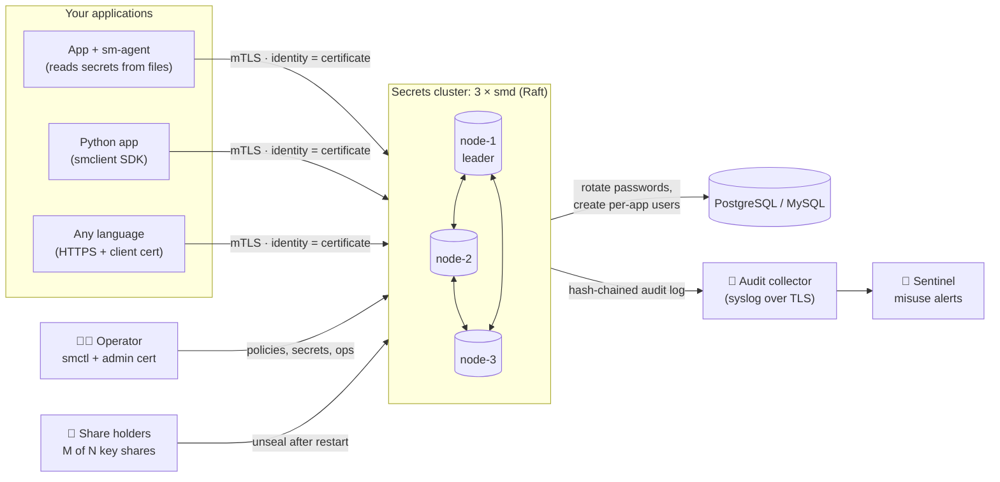

<div align="center">

# 🔐 Secrets Manager

**Your own secrets vault. Self-hosted, open source, and dependent on no third-party service.**

Encrypted storage · Shamir-split unseal keys · certificate identities for every service · automatic rotation · tamper-evident audit · built-in misuse alerts

[](https://github.com/hamad-tariq/SecretsManager/actions/workflows/ci.yml)
[](LICENSE)
[](go.mod)
[](sdk/python)
[](#-what-is-it)
[](#-project-status)
[](SECURITY.md)

[What is it](#-what-is-it) ·
[What it's for](#-what-its-for) ·
[Who it's for](#-who-can-use-it) ·
[When to use it](#-when-to-use-it-and-when-not-to) ·
[Quick start](#-quick-start) ·
[Docs](#-documentation) ·
[Disclaimers](#-disclaimers) ·
[Contributing](#-contributing)

</div>

---

> [!WARNING]
> **Experimental software: not independently audited.** Secrets Manager has been reviewed internally (17 findings, all fixed) but has **not** had an external security audit or penetration test. Use it to learn, evaluate, run labs and protect non-critical systems. **Don't use it for production secrets** until it has been reviewed by someone other than its author. See [Disclaimers](#-disclaimers).

## 🧭 What is it

Every application has secrets: database passwords, API keys, certificates, signing keys. Most end up in `.env` files, CI variables, or a cloud provider's secret service. **Secrets Manager** is a vault you run yourself on three servers you control. Apps get secrets from it over mutually authenticated TLS, each app sees only what its policy allows, every access is logged in a tamper-evident audit trail, and nothing ever leaves your infrastructure.



It's a single Go codebase with three binaries, plus a Python SDK and an alerting tool. It needs no cloud KMS, no external database, no identity provider and no hosted service.

### ✨ Highlights

| | |
|---|---|
| 🔒 **Encrypted at rest** | Every stored value is encrypted (XChaCha20-Poly1305) and bound to its path. Disks, backups and snapshots are useless without the key. |
| 🧩 **Shamir unseal** | The master key is split into N shares, M of which are needed (default 3 of 5). No single person, and no single stolen server, can open the vault. Shares can be encrypted to each holder's [`age`](https://age-encryption.org) key. |
| 🪪 **Certificate identities** | Every service, admin and node authenticates with a certificate from the built-in CA. There are no passwords or static API tokens to leak. Service certificates last 24 h and renew automatically. |
| 📜 **Policies** | Path-based rules, deny by default, explicit deny wins. `create` is separate from `update`, and listing is its own permission. |
| 🗂️ **Versioned secrets** | Keeps 10 versions with `current` / `previous` / `pending` labels, check-and-set writes, and a 7-day undelete window. |
| 🔄 **Automatic rotation** | Scheduled, zero-downtime rotation of random values and PostgreSQL/MySQL passwords, or through an HTTP hook to your own service. |
| 🎟️ **Dynamic DB credentials** | Each app instance gets its own short-lived database user, which is dropped (and its sessions killed) when the lease ends. |
| ☸️ **Kubernetes-native login** | Pods log in with their service account. `sm-agent` runs as an init container or sidecar and writes secrets to tmpfs files. |
| 🧾 **Tamper-evident audit** | Every request is logged in a hash chain, secret values never appear in it, and it's forwarded off-host over TLS syslog. The API **fails closed** if the audit log can't be written. |
| 🚨 **Built-in misuse alerts** | Sentinel reads the audit stream and flags stolen certificates, bulk reads, probing, rate spikes, off-hours admin use and log tampering. |
| 🛡️ **Revocation** | Revoke a certificate *and every renewal made from it*, or a whole identity. Share holders can hand root-admin rights to someone else. |
| 🧰 **Operable** | Encrypted snapshots, a disaster-recovery drill, Prometheus metrics, health endpoints, runbooks, and reproducible, signed release builds. |

## 🎯 What it's for

- **Getting secrets out of code, `.env` files and CI variables** into one encrypted, access-controlled, audited place.
- **Giving every service its own identity** so that "which app read the payments key at 03:12?" has an answer.
- **Rotating database passwords on a schedule** without restarting apps or dropping connections.
- **Short-lived, per-instance database users**, so a leaked credential expires on its own and can be traced to the pod that held it.
- **Keeping secrets entirely on your own infrastructure**, for air-gapped, on-prem, sovereignty-sensitive or cloud-agnostic setups.
- **Learning how a real secrets manager works**, end to end: envelope encryption, Shamir sharing, Raft consensus, an internal PKI, hash-chained audit logs and anomaly rules. All of it in about 9,000 lines of readable Go, with the design decisions written down.

## 👥 Who can use it

Anyone: the [Apache-2.0 license](LICENSE) allows personal, educational and commercial use, including modification and redistribution (see [Obligations](#-obligations)).

| You are… | It's a good fit because… | Keep in mind |
|---|---|---|
| 🧑‍🎓 **A student or learner** | Every security mechanism is implemented in plain sight and explained in the [plan](IMPLEMENTATION_PLAN.md) and [threat model](docs/threat-model.md). | Read the "why" in the docs alongside the code. |
| 🏠 **A homelab or self-hosting enthusiast** | One small cluster, with no cloud accounts and no paid tiers. | Keep the unseal shares somewhere safe: lose them and the data is gone. |
| 🚀 **A small team or startup** | A real alternative to scattered `.env` files, with identities, audit and rotation. | Experimental: keep it to non-critical systems until it's been audited. |
| 🏢 **A platform or DevOps engineer evaluating options** | A compact reference for mTLS identities, rotation and dynamic credentials, running in a lab in minutes. | Compare it with mature tools (below) before committing. |
| 🔍 **A security researcher** | A small, readable attack surface with a published threat model. Findings are welcome and credited. | Please report privately: [SECURITY.md](SECURITY.md). |

## 🕒 When to use it (and when not to)

| ✅ Use it when… | ❌ Don't use it (yet) when… |
|---|---|
| You want secrets to stay entirely on infrastructure you control | You need a vendor-supported, externally audited product today |
| You're learning, prototyping, running a lab, or protecting non-critical systems | You're protecting production payment, health or regulated data |
| You want identities, audit and rotation without adopting a large platform | You need a web UI, many auth methods (LDAP, OIDC…) or a large plugin ecosystem |
| You can run 3 Linux nodes and keep unseal shares with 3+ people | Nobody can be reached to unseal after a full restart (unsealing is manual by design) |
| You value a small codebase you can read and audit yourself | You need compliance certifications from your secrets vendor |

<details>
<summary><b>How does it compare to other tools?</b></summary>

<br/>

| | **Secrets Manager** | **HashiCorp Vault / OpenBao** | **Cloud secret managers** (AWS, GCP, Azure) |
|---|---|---|---|
| Where it runs | Your servers only | Your servers (Vault is also offered as a managed service) | The cloud provider |
| License | Apache-2.0 | Vault: BUSL-1.1 · OpenBao: MPL-2.0 | Proprietary service |
| Maturity | **Experimental, not externally audited** | Mature, widely deployed | Mature, fully managed |
| Scope | Small on purpose: KV, PKI identities, rotation, dynamic DB users, audit, alerts | Very broad: many secret engines and auth methods, plugins | Integrated with that provider's IAM and services |
| Outside dependencies | None | None required | The provider's account and IAM |
| Misuse detection | Built in (Sentinel) | Via external tooling | Via the provider's monitoring |

If you need a proven, supported product today, choose one of the mature options. Secrets Manager is for people who want something small, fully self-contained and understandable, and are willing to try an early project.

</details>

## 🚀 Quick start

### Try it in about two minutes

A local 3-node cluster on `127.0.0.1`: certificates are created, the cluster is initialised and unsealed, and a first secret is stored.

**You need:** [Go 1.27](https://go.dev/dl/), Python 3.10+, `curl`, and a Bash shell. On Windows, use **Git Bash** (it comes with Git for Windows) or WSL.

```bash
git clone https://github.com/hamad-tariq/SecretsManager.git
cd SecretsManager
scripts/try-local.sh          # build → certificates → 3 nodes → init → unseal → first secret
```

Then point the CLI at it:

<details open>
<summary><b>Bash / Git Bash / macOS / Linux</b></summary>

```bash
export PATH="$PWD/try/bin:$PATH"
export SM_ADDR=127.0.0.1:8210,127.0.0.1:8220,127.0.0.1:8230
export SM_CA=try/ca/root.pem SM_CERT=try/certs/alice.pem SM_KEY=try/certs/alice.key
```

</details>

<details>
<summary><b>Windows PowerShell</b></summary>

```powershell
$env:PATH    = "$PWD\try\bin;$env:PATH"
$env:SM_ADDR = "127.0.0.1:8210,127.0.0.1:8220,127.0.0.1:8230"
$env:SM_CA   = "try\ca\root.pem"
$env:SM_CERT = "try\certs\alice.pem"
$env:SM_KEY  = "try\certs\alice.key"
```

</details>

```bash
smctl operator status                 # 3 nodes: one leader, all unsealed
smctl kv put app/api-key              # type a value (not echoed)
smctl kv get -reveal app/api-key
smctl kv history app/api-key
smctl -h                              # every command
```

Stop it with `scripts/try-local.sh stop`, bring it back (it restarts sealed and gets unsealed) with `scripts/try-local.sh start`, or delete everything with `scripts/try-local.sh clean`.

> [!CAUTION]
> `try/` holds the test CA key, every certificate and all the unseal shares on one disk. That's fine for trying it out, and exactly what you must never do for real. It's in `.gitignore`.

### Use it from your application

First, as an admin, give the app an identity and a policy (once per service):

```bash
smctl pki upload -cert try/ca/intermediate.pem -key try/ca/intermediate.key   # the cluster may now issue service certs
echo '{"name":"orders","rules":[{"path":"kv/app/*","capabilities":["read"]}]}' > orders.json
smctl policy write orders orders.json
smctl identity bind svc/orders-api orders

# A single-use enrollment token for the service, valid 15 minutes:
smctl enroll token -service orders-api | sed -n 's/.*"token": "\(.*\)".*/\1/p' > token.txt
```

Then pick how the app reads its secrets:

<details open>
<summary><b>1 · Files via <code>sm-agent</code>: any language, no code changes</b></summary>

```bash
# Exchanges the token for a certificate, keeps it renewed, and writes the secret to a file.
sm-agent -auth token -token-file token.txt -out ./secrets -secret app/api-key=api-key
cat ./secrets/api-key
```

On Kubernetes, the agent logs in with the pod's service account instead (`-auth kubernetes`) and writes to a tmpfs volume. See [deploy/k8s/orders-api-example.yaml](deploy/k8s/orders-api-example.yaml).

</details>

<details>
<summary><b>2 · Python SDK: caching, refresh, keeps working if the cluster is briefly unreachable</b></summary>

```python
from smclient import Client   # pip install ./sdk/python  (standard library only)

sm = Client.from_agent_dir(["127.0.0.1:8210", "127.0.0.1:8220"], "./secrets")
api_key = sm.get("app/api-key").reveal()
```

</details>

<details>
<summary><b>3 · Plain HTTPS: any language with a TLS client certificate</b></summary>

```bash
curl --cert secrets/tls.crt --key secrets/tls.key --cacert secrets/ca.crt \
     https://127.0.0.1:8210/v1/kv/app/api-key
# {"path":"app/api-key","value":"...","version":1,"created":"..."}
```

Windows' built-in `curl` can't use PEM client certificates. Use another HTTP client there.

</details>

### Going to a real deployment?

Read the [production checklist](docs/production-checklist.md) and the [runbooks](docs/runbooks/README.md). The root CA belongs on an offline machine, each share with a different person, and backups on storage the nodes can't write to. Production binaries target Linux (amd64 and arm64) and are built with `scripts/release.sh`.

## 🧱 Components

| Component | What it does |
|---|---|
| **`smd`** | The server. Three of them form a Raft cluster, and each one encrypts, authorises, audits and serves requests. |
| **`smctl`** | Operator CLI: PKI, init/unseal/rekey, secrets, policies, rotation, leases, revocation, snapshots, cluster membership, audit verification. |
| **`sm-agent`** | Runs next to your app: logs in (token or Kubernetes), renews its certificate, and keeps secrets and database credentials in files. |
| **`smclient`** | Python SDK (standard library only), with caching, refresh and serving the last good value on errors. |
| **Sentinel** | Python (standard library only). Watches the audit stream and alerts via a log file, stdout or a webhook (Alertmanager, Mattermost, Slack-compatible). |

## 📚 Documentation

- 📖 **[Full documentation site](https://hamad-tariq.github.io/SecretsManager/)**: getting started, concepts, component guides, how-tos and the complete API reference
- 🧠 [Design and implementation plan](IMPLEMENTATION_PLAN.md): architecture, every iteration, and the security review findings
- 🛡️ [Threat model](docs/threat-model.md): assets, trust boundaries, mitigations and **known gaps**
- ✅ [Production checklist](docs/production-checklist.md)
- 🧯 [Runbooks](docs/runbooks/README.md): unseal, lost node, lost quorum, restore, compromised certificate, compromised share holder, upgrades
- 🚨 [Sentinel](sentinel/README.md): rules and alert routing

## 📊 Project status

**Version 0.1.0: first public release, experimental.**

- ✅ Everything listed under [Highlights](#-highlights) is implemented and tested: about 130 Go test functions and 34 Python tests, including a disaster-recovery drill, cluster failover, real-database rotation tests, and log-tampering scenarios.
- ✅ Every change passes `gofmt`, `go vet`, `staticcheck`, `gosec` and `govulncheck`.
- ✅ An internal security review against the threat model found 17 issues (one high severity). All are fixed and covered by tests.
- ❌ **No external audit or penetration test yet.** This is the main thing between this project and production use.
- ❌ No web UI. It's CLI and API only, by design for now.

It's maintained by one person. If it gets interest, the next steps are fuzzing, failure-injection testing of the cluster, and an external audit. Stars and feedback make that more likely. ⭐

## 🚩 Disclaimers

> [!IMPORTANT]
> Please read these before you use the software.

- **No warranty, no liability.** The software is provided **"AS IS", WITHOUT WARRANTIES OR CONDITIONS OF ANY KIND**, express or implied, and in no event is the author or any contributor liable for any damages arising from its use, including loss of data, loss of secrets, or security breaches. See sections 7 and 8 of the [Apache License 2.0](LICENSE).
- **Not audited.** The cryptography and access control have been reviewed only by the author. Undiscovered vulnerabilities are likely. Keep that in mind for anything valuable.
- **Losing the shares means losing the data.** Encrypted data can't be recovered without a threshold of unseal shares. There is no backdoor and no recovery service, by design.
- **You are the operator.** You alone are responsible for how you deploy, configure, secure and back it up, for who holds the keys and shares, and for meeting the laws and regulations that apply to the data you store (for example GDPR, HIPAA, PCI DSS). This project makes no compliance claims.
- **No telemetry.** The software never phones home. It contacts only what you configure: your nodes, your Kubernetes API, your databases, your rotation hooks and your audit collector. The CI checks (`govulncheck`) query the public Go vulnerability database.
- **Not affiliated.** This is an independent project. It is not affiliated with, endorsed by or connected to Amazon Web Services ("AWS Secrets Manager"), HashiCorp, the OpenBao project, Google, Microsoft or any other company. Product names are trademarks of their respective owners and are used only to describe compatibility or comparison.
- **Cryptography notice.** This software includes cryptographic functionality. The country in which you reside may restrict the import, possession, use or re-export of encryption software. Check your country's laws before using or redistributing it.

## 📋 Obligations

The license is permissive, but it does come with conditions. In short (the [LICENSE](LICENSE) text is what counts):

<details open>
<summary><b>If you use it (internally, commercially, anywhere)</b></summary>

- You may use, modify and run it for any purpose, including commercially, free of charge.
- No trademark rights are granted: don't present your product as "the official Secrets Manager" or imply endorsement by the author (license §6).
- If you start **patent litigation** claiming this software infringes a patent, your patent license under Apache-2.0 ends (§3).

</details>

<details>
<summary><b>If you redistribute it (source or binaries, modified or not)</b></summary>

Under Apache-2.0 §4 you must:

1. give recipients a copy of the [LICENSE](LICENSE);
2. mark files you modified with a prominent notice that you changed them;
3. keep all copyright, patent, trademark and attribution notices from the source;
4. include the [NOTICE](NOTICE) file (or its contents) in what you distribute.

Also note the **MPL-2.0 parts**:
- `internal/crypto/shamir/shamir.go` (ported from OpenBao) stays under MPL-2.0, and changes to it must be published under MPL-2.0;
- binaries include unmodified MPL-2.0 Go modules (such as `hashicorp/raft`), so recipients must be told where to get their source. [THIRD_PARTY_NOTICES.md](THIRD_PARTY_NOTICES.md) does that. Ship it with your binaries.

</details>

<details>
<summary><b>If you operate it (your responsibilities, not the license's)</b></summary>

- Keep the root CA key offline, give each unseal share to a different trusted person, and rehearse the [runbooks](docs/runbooks/README.md).
- Take and test backups (`smctl snapshot save` / `verify`) on storage the nodes can't write to.
- Forward the audit log off-host and actually look at the alerts.
- Handle the data you store according to your legal and contractual duties, including breach notification.

</details>

<details>
<summary><b>If you contribute</b></summary>

- Contributions are accepted under Apache-2.0 (license §5); changes to the MPL-2.0 file above are under MPL-2.0.
- Only submit work you have the right to license, including your employer's permission where needed.
- Report vulnerabilities privately ([SECURITY.md](SECURITY.md)) and follow the [Code of Conduct](CODE_OF_CONDUCT.md).

</details>

## 🔒 Security

Found a vulnerability? **Please don't open a public issue.** Report it privately through GitHub's *Report a vulnerability* (Security tab) or by email to **hammadt451@gmail.com**. Details, scope and response times are in [SECURITY.md](SECURITY.md). Reports are credited.

## 🤝 Contributing

All kinds of contributions are welcome:

- 🔍 **Review the crypto and access-control code.** The most valuable contribution right now.
- 🐛 **Try it and report what breaks**, with `scripts/try-local.sh` as a starting point.
- 📝 **Improve the docs**, where anything that confused you counts as a bug.
- 🧪 **Add tests**, especially fuzzing and failure injection.
- 💡 **Share how you'd use it** in Discussions.

Start with [CONTRIBUTING.md](CONTRIBUTING.md) and issues labelled `good first issue`. If you find the project useful or interesting, **a ⭐ helps others find it.**

## ❓ FAQ

<details>
<summary><b>Is it ready for production?</b></summary>

Not yet. The code is complete for its scope and well tested, but it hasn't had an independent security audit. Use it for learning, labs and non-critical systems.

</details>

<details>
<summary><b>What happens when a node restarts?</b></summary>

It comes back **sealed**: it can't decrypt anything until M share holders unseal it (`smctl operator unseal`). The other nodes keep serving meanwhile. Auto-unseal isn't implemented, deliberately. See [unseal-after-restart](docs/runbooks/unseal-after-restart.md).

</details>

<details>
<summary><b>What if I lose the unseal shares?</b></summary>

With fewer than M shares, the data can't be decrypted by anyone, ever. Keep shares with different people, and use `smctl operator rekey` to issue new ones when someone leaves.

</details>

<details>
<summary><b>Does it need Kubernetes?</b></summary>

No. Kubernetes login is optional. VMs, Docker hosts and bare metal use single-use enrollment tokens with `sm-agent`.

</details>

<details>
<summary><b>Which languages can use it?</b></summary>

Any. `sm-agent` writes secrets to files, and the API is plain HTTPS with a client certificate. There's a Python SDK; others are welcome as contributions.

</details>

<details>
<summary><b>Which databases can it rotate or issue users for?</b></summary>

PostgreSQL and MySQL. Anything else can be rotated through the HTTP hook plugin, which calls a small service you write.

</details>

<details>
<summary><b>Why is there no web UI?</b></summary>

A UI adds a large attack surface, and it wasn't needed to prove the core. It may come later if there's demand.

</details>

<details>
<summary><b>Does it run on Windows or macOS?</b></summary>

For development and trying it out, yes. Production release builds target Linux (amd64 and arm64).

</details>

## 👤 Author

**Hammad Tariq**, creator and maintainer
🌐 [thehammadtariq.com](https://thehammadtariq.com) · ✉️ [hammadt451@gmail.com](mailto:hammadt451@gmail.com)

## 📄 License

Copyright 2026 Hammad Tariq.

Licensed under the [Apache License, Version 2.0](LICENSE). `internal/crypto/shamir/shamir.go` is under the [Mozilla Public License 2.0](https://mozilla.org/MPL/2.0/); see [NOTICE](NOTICE) and [THIRD_PARTY_NOTICES.md](THIRD_PARTY_NOTICES.md).

<div align="center">
<sub>Built from first principles: no cloud KMS, no hosted services, no telemetry.</sub>
</div>
