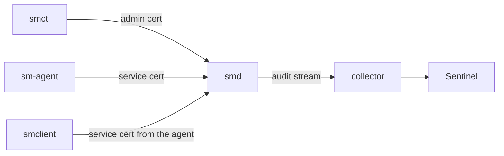

# Components

| Component | What it is | Page |
|---|---|---|
| **`smd`** | The server node. Three form a cluster. | [smd (server)](smd.md) |
| **`smctl`** | The operator CLI: every administrative action, plus offline PKI and audit verification. | [smctl (CLI)](smctl.md) |
| **`sm-agent`** | Runs next to an application: logs in, renews its certificate, writes secrets and database credentials to files. | [sm-agent](sm-agent.md) |
| **`smclient`** | The Python SDK, with caching, background refresh, serving the last value on errors, and dynamic credentials. | [Python SDK](python-sdk.md) |
| **Sentinel** | Reads the audit stream and raises alerts about misuse and tampering. | [Sentinel](sentinel.md) |

