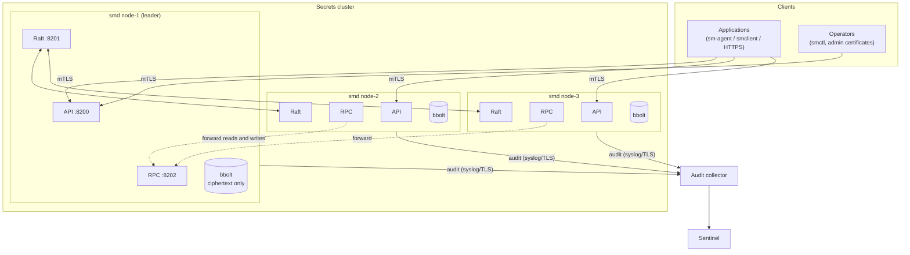
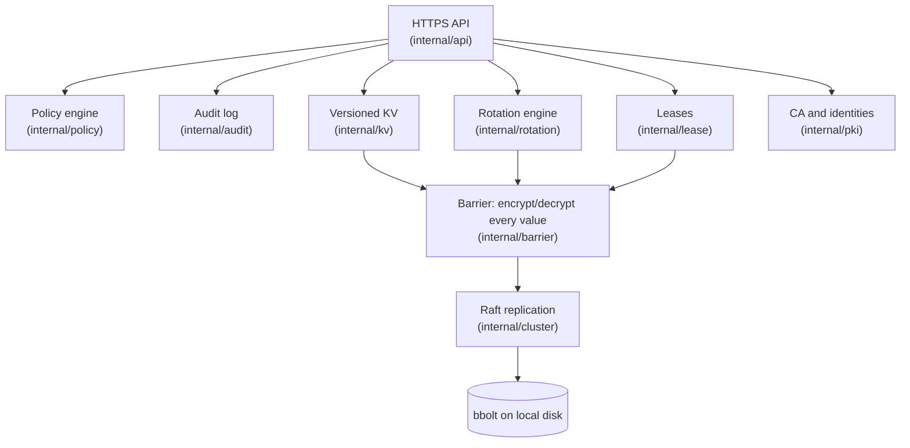
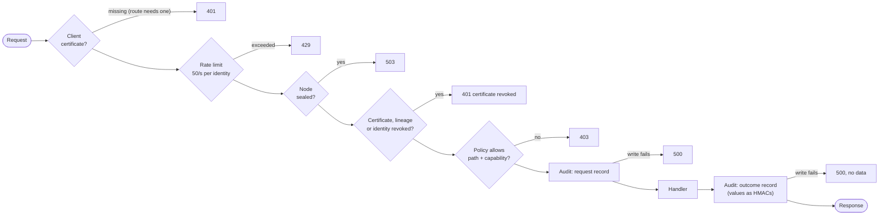
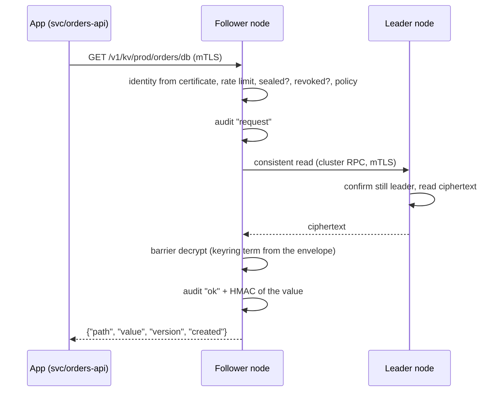

# Architecture

## Components

| Component | Language | Runs where | Role |
|---|---|---|---|
| `smd` | Go | 3 servers (Linux) | The server node: Raft storage, the encryption barrier, the HTTPS API, rotation and lease expiry. |
| `smctl` | Go | Operator laptops, the offline CA machine | CLI for everything an operator does: PKI, init/unseal, secrets, policies, operations. |
| `sm-agent` | Go | Next to each application | Logs in, keeps the service certificate renewed, writes secrets and database credentials to files. |
| `smclient` | Python | Inside Python applications | SDK: mTLS client with caching, background refresh and serving the last value on errors. |
| Sentinel | Python | Next to the audit collector | Reads the audit stream and raises alerts. Never talks to the cluster. |

## Runtime topology

Each node listens on three ports. The numbers are only conventions; you choose them with flags.

| Port (example) | Flag | Who connects | Accepts |
|---|---|---|---|
| 8200 | `-api-addr` | applications, operators, load balancers | any certificate from the CA (TLS 1.3); `sys/health` and the login endpoints work without one |
| 8201 | `-raft-addr` | other nodes | node certificates of current members only |
| 8202 | `-rpc-addr` | other nodes (join, forwarding) | node certificates only; join is refused for removed node IDs |

## Layers inside a node

- Everything **above** the barrier sees plaintext; everything **below** it (Raft, disks, snapshots) sees only ciphertext.
- The barrier works only while the node is **unsealed**. A sealed node holds no keys, so it can replicate data but can't read any of it.

## The request pipeline

Every API request passes the same checks, in this order. The first failure ends the request.

Things that follow from this order:

- **Policy is checked before existence.** A caller without access gets `403` whether or not the path exists, so secret names can't be probed.
- **Fail closed on audit.** If the log can't be written, the caller gets `500` and never the data. The same happens when audit forwarding falls too far behind (`-audit-forward-max-lag`).
- **Revocation beats policy.** A revoked certificate is refused even if it belongs to the root admin.

## Reading a secret, end to end

Reads are **linearizable**: the leader answers only after confirming it's still the leader, so a client never sees a value older than one it already wrote.

## Source layout

| Path | What |
|---|---|
| `cmd/smd`, `cmd/smctl`, `cmd/sm-agent` | the three binaries |
| `internal/crypto/aead` | XChaCha20-Poly1305 envelope |
| `internal/crypto/shamir` | Shamir secret sharing over GF(2⁸) |
| `internal/barrier` | key hierarchy, encryption of every value, seal/unseal/rekey |
| `internal/cluster` | Raft (hashicorp/raft + bbolt), join, forwarding, membership |
| `internal/storage` | the key/value interface every layer uses |
| `internal/api` | HTTPS server and request pipeline |
| `internal/policy` | policy parsing and evaluation |
| `internal/pki` | CA, certificates, identities |
| `internal/kv` | versioned secrets |
| `internal/rotation` | scheduled rotation and plugins |
| `internal/lease` | dynamic database users |
| `internal/audit` | hash-chained log, verification, forwarding |
| `internal/snapshot` | backup file format |
| `internal/metrics` | Prometheus text output |
| `internal/agent` | the logic behind `sm-agent` |
| `internal/secret` | a value type that refuses to print itself |
| `sdk/python` | `smclient` |
| `sentinel` | Sentinel |
