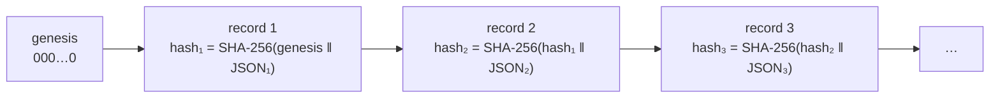

# Audit log

Every API request is recorded in an **append-only, hash-chained** log on each node. You can tell afterwards who did what, from where, and whether the log was tampered with.

## What a record looks like

Each request produces two records, `request` and then its outcome (`ok`, `denied:403`, `error:500`, …), linked by `request_id`:

```json
{"seq":80,"time":"2026-09-24T11:50:24.7512233Z","request_id":"dfb1ef574df64574","identity":"spiffe://sm/admin/alice","op":"kv.read","path":"kv/prod/orders/api-key","result":"request","source_ip":"127.0.0.1","cert_serial":"14835837262f13fab7bd1500ee815a6d","prev":"…","hash":"5aa9a9dc…"}
{"seq":81,"time":"2026-09-24T11:50:24.7633959Z","request_id":"dfb1ef574df64574","identity":"spiffe://sm/admin/alice","op":"kv.read","path":"kv/prod/orders/api-key","result":"ok","source_ip":"127.0.0.1","cert_serial":"14835837262f13fab7bd1500ee815a6d","prev":"5aa9a9dc…","hash":"3ed2f611…"}
```

The fields are described in the [audit record format reference](../reference/audit-format.md).

## The hash chain



Each record's `hash` covers the previous record's hash and its own content. Editing, deleting, inserting or reordering any line breaks every hash after it:

```console
$ smctl audit verify /var/lib/smd/audit.log
ok: 77 records, head ae9dde023a49c561235a1f0c63f95b35dc8ca91ac49ba8a2959241e4d41df071
```

`audit verify` also requires each line to be in the logger's exact byte encoding, so a line can't be crafted to decode "the same" for the verifier while reading differently to people or other tools.

!!! info "Truncation needs an outside reference"
    Someone with root on a node could cut the log back and keep a valid chain. Catch that with the last record the off-host collector received:
    ```bash
    smctl audit verify -head 81:3ed2f611d8faf496c88e30db8998210786bbcf4cab8d038c279c5608f5ea187f audit.log
    ```
    This fails if the log doesn't contain record 81 with that hash.

## Secret values are never logged

When an operation involves a secret value (a KV read or write, dynamic credentials), the log stores an **HMAC-SHA256 fingerprint** of the value under `hmacs`, never the value itself. The HMAC key is generated at first unseal and shared by all nodes (stored behind the barrier), so the same value has the same fingerprint everywhere. Someone holding the key can answer "was *this* value handed out?" without the log containing any secrets.

## Fail closed

- If a node can't write its audit log, the request fails with `500` and **no data is returned**.
- With forwarding enabled, a node that has more than `-audit-forward-max-lag` bytes (default 64 MiB) not yet delivered to the collector also refuses requests. Nothing goes unrecorded off-host for long.

## Forwarding off-host

A node's own log can't protect against someone with root on that node. Forward it:

```bash
smd … -audit-forward collector.internal:6514 [-audit-forward-ca collector-ca.pem]
```

- **Transport.** Syslog over TLS (RFC 5425 framing, RFC 5424 messages), authenticated with the node's own certificate. Each message looks like `<110>1 <time> <node-id> smd - - - {json record}`.
- **Buffering.** The local file is the buffer. A `.forwarded` file next to it remembers how far delivery got, so a collector outage only delays delivery. When the connection comes back, everything is sent.
- **Refusing a shortened log.** If the local log turns out shorter than what was already forwarded (truncated or replaced), forwarding stops and requests fail until someone investigates.

Set up the collector and alerts with [Audit forwarding and alerts](../guides/audit-forwarding.md).

## Operation names

The `op` field names the API operation, for example `kv.read`, `kv.write`, `kv.delete`, `auth.enroll`, `auth.kubernetes`, `auth.renew`, `db.creds`, `lease.renew`, `sys.init`, `sys.unseal`, `sys.seal`, `sys.rekey`, `sys.policy.write`, `sys.binding.write`, `sys.revocation.add` and `sys.snapshot.save`. The [HTTP API reference](../reference/http-api.md) lists the operation name of every endpoint.

Health checks and metrics scrapes are **not** audited; they'd flood the log and expose nothing secret.
