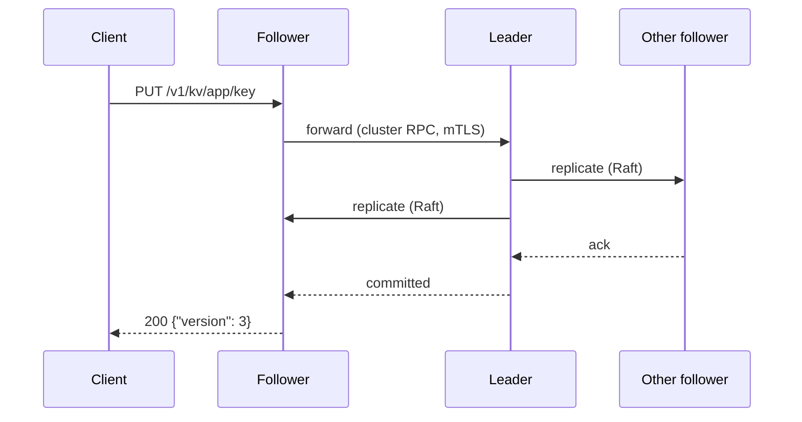

# Clustering

A cluster is normally **three `smd` nodes** replicating one store with [Raft](https://raft.github.io) (the `hashicorp/raft` library, with `bbolt` on each node's local disk). Raft data is barrier ciphertext, so replication traffic and disks never see a plaintext value.

## Quorum

A write succeeds once a **majority** of voters has it. With three nodes:

| Nodes up | State |
|---|---|
| 3 of 3 | healthy |
| 2 of 3 | healthy: one node can fail, or be upgraded, without downtime |
| 1 of 3 | **no quorum**: no leader, no reads or writes. See [Lost quorum](../runbooks/lost-quorum.md) |

Five nodes tolerate two failures, but every write then waits for three. Three is the recommended size.

## Leader and followers



- **Any node accepts requests.** Followers forward writes and reads to the leader over the cluster RPC port, so clients can use every node, or a load balancer in front of them.
- **Reads are linearizable.** The leader serves a read only after confirming it's still the leader.
- **Background work runs on the leader only.** That covers scheduled rotations and lease expiry. A new leader resumes where the old one stopped, because progress is saved after every step.

## Each node is sealed separately

Replication doesn't carry keys. Every node that starts is **sealed** until share holders unseal it, even if the others are unsealed. `smctl operator unseal` sends each share to every address in `SM_ADDR` for this reason.

A sealed node still takes part in Raft (it replicates and votes); it just can't serve API requests (`503`).

## Forming and joining

```bash
# First node, once, ever:
smd -id node-1 -bootstrap -data /var/lib/smd \
    -api-addr 10.0.0.1:8200 -raft-addr 10.0.0.1:8201 -rpc-addr 10.0.0.1:8202 \
    -cert node-1.pem -key node-1.key -ca root.pem

# Every other node:
smd -id node-2 -join 10.0.0.1:8202 -data /var/lib/smd \
    -api-addr 10.0.0.2:8200 -raft-addr 10.0.0.2:8201 -rpc-addr 10.0.0.2:8202 \
    -cert node-2.pem -key node-2.key -ca root.pem
```

- `-id` must match the node certificate (`spiffe://sm/node/<id>`), and a node can only join **as itself**.
- `-join` takes any current member's RPC address; the join is forwarded to the leader.
- The node certificate must list the host names or IPs that clients and other nodes use (`-host` when issuing).
- After the first start, a node rejoins on its own from its data directory. `-bootstrap` and `-join` only matter the first time.

## Membership operations

```console
$ smctl operator members
{
  "leader": "node-2",
  "members": { "node-1": "127.0.0.1:8211", "node-2": "127.0.0.1:8221", "node-3": "127.0.0.1:8231" },
  "voters": ["node-1", "node-2", "node-3"]
}
```

| Command | When | Needs |
|---|---|---|
| `smctl operator step-down` | before upgrading or rebooting the leader, to hand over leadership cleanly | `update` on `sys/cluster` |
| `smctl operator remove-node node-3` | a node is dead for good; quorum is then counted over the rest | `update` on `sys/cluster` |

!!! warning "Removed means banned"
    A removed node ID can never rejoin. Its certificate may still be valid, so the cluster keeps it out by ID at the Raft, RPC and join layers. A replacement node joins under a **new** ID (e.g. `node-4`) with its own certificate. See [Lost node](../runbooks/lost-node.md).

## Failure behaviour

| Event | What happens |
|---|---|
| A follower dies | Nothing visible; it catches up when it returns (sealed, so it needs unsealing). |
| The leader dies | A new leader is elected within seconds. Requests in flight may fail and should be retried. `smclient` and `sm-agent` try the next address. |
| Network partition | The side with a majority keeps working; the minority stops serving. |
| All nodes restart | Everything comes back sealed. See [Unseal after a restart](../runbooks/unseal-after-restart.md). |
