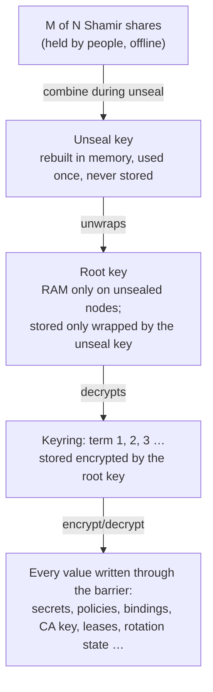

# Encryption and sealing

## The key hierarchy



| Key | Where it lives | If an attacker gets it |
|---|---|---|
| Shares | With share holders, never on the cluster | M of them rebuild the unseal key |
| Unseal key | Nowhere: rebuilt during unseal and rekey, then wiped | Decrypts the stored root key |
| Root key | Locked memory (`memguard`) on unsealed nodes | Decrypts the keyring |
| Keyring | Raft storage (encrypted), locked memory when unsealed | Decrypts every value |

## The barrier

Every value is encrypted before it reaches Raft or the disk, with **XChaCha20-Poly1305** from `golang.org/x/crypto`:

```text
version (1 byte) ‖ keyID (4 bytes, big endian) ‖ nonce (24 bytes, random) ‖ ciphertext + tag (16 bytes)
```

- **The nonce is random.** XChaCha's 24-byte nonce makes random nonces safe at any realistic volume, so there are no counters that could repeat.
- **The keyID** says which keyring term encrypted the value, so old values stay readable after a rotation.
- **Values are bound to their storage key.** The key name, plus the version and keyID, is authenticated as additional data, so ciphertext copied to another path fails to decrypt.

!!! note "Key names are not encrypted"
    Storage keys, which include secret paths such as `kv/prod/orders/db`, are stored in plaintext so the cluster can list and replicate them. Don't put secrets in paths.

## Initialisation

`init` runs once per cluster:

```console
$ smctl operator init -shares 5 -threshold 3
Distribute each share to a different holder NOW. They are shown only once and never stored.
{
  "shares": ["AbC…", "DeF…", "GhI…", "JkL…", "MnO…"]
}
```

It:

1. creates a random unseal key, splits it into **N** shares with threshold **M** (2 ≤ M ≤ N ≤ 255), and returns them **once**;
2. creates the root key and the first keyring term, and stores the root key wrapped by the unseal key;
3. makes the **calling admin the root admin** (see [Policies](policies.md#the-root-admin));
4. leaves every node **sealed**. Unsealing proves the shares work.

### Encrypting shares to their holders

With one [`age`](https://age-encryption.org) public key per share, each share is encrypted to its holder, and nobody else, including whoever ran `init`, ever sees it in the clear:

```bash
smctl operator init -shares 3 -threshold 2 \
  -recipient age1ql3z7hjy54pw3hyww5ayyfg7zqgvc7w3j2elw8zmrj2kg5sfn9aqmcac8p \
  -recipient age1… -recipient age1…
```

Each holder decrypts and unseals in one step:

```bash
age -d -i my-key.txt share.age | smctl operator unseal
```

## Unsealing

A node starts sealed every time the process starts. Each node is unsealed separately. `smctl operator unseal` sends one share to **every** address in `SM_ADDR`:

```console
$ smctl operator unseal
Unseal share: ********
```

- Each share holder submits their own share. On a terminal it's read without echo, and from stdin when piped.
- Once a node has **M** shares it rebuilds the unseal key, unwraps the root key, loads the keyring and starts serving.
- Wrong shares can't be told apart from right ones mathematically. The node finds out when the root key fails to decrypt (its authentication tag doesn't match), then **discards all progress** without revealing which share was wrong.
- Progress is forgotten after **10 minutes** of inactivity.
- Unsealing requires an **admin certificate** (any admin, even one with no permissions), so anonymous callers can't jam an unseal with junk shares.

## Sealing

```bash
smctl operator seal        # one node: the first in SM_ADDR that answers
smctl operator seal -all   # every node
```

Sealing wipes the keys from memory immediately. Use it when you suspect a node is compromised; the data is safe, and unsealing needs the share holders again. Requires `update` on `sys/seal`.

## Rotating the encryption key

```console
$ smctl operator rotate
{
  "term": 2
}
```

Adds a keyring term. New writes use it, and old values stay readable with their original term. Requires `update` on `sys/rotate`.

## Rekey: new shares

Rekey replaces the shares (and can change N and M) **without** re-encrypting data and without unsealing again:

```bash
smctl operator rekey -shares 5 -threshold 3      # prompts for M current shares
```

It re-wraps the root key with a new unseal key and prints the new shares. The old shares stop working. Do this whenever a share holder leaves. See [Shares, rekey and root admin](../guides/key-ceremonies.md).

!!! warning "If rekey prints a warning, keep the shares"
    If the storage write's outcome is uncertain (for example the leader changed mid-write), rekey still prints the new shares **with a warning** instead of withholding them. Keep both the old and the new shares until an unseal confirms which set works.

## What sealing does and doesn't protect

| Scenario | Protected? |
|---|---|
| A disk, snapshot or backup is stolen | :material-check: Only ciphertext; useless without M shares |
| A sealed node's host is compromised | :material-check: No keys in memory |
| One share holder goes rogue | :material-check: One share reveals nothing (information-theoretically) |
| An **unsealed** node's host is fully compromised (root access) | :material-close: Keys are in its memory; seal it and treat all secrets as exposed |
| M share holders collude | :material-close: That's the threshold, by design |

See the [threat model](../threat-model.md) for the full list, including known gaps.
