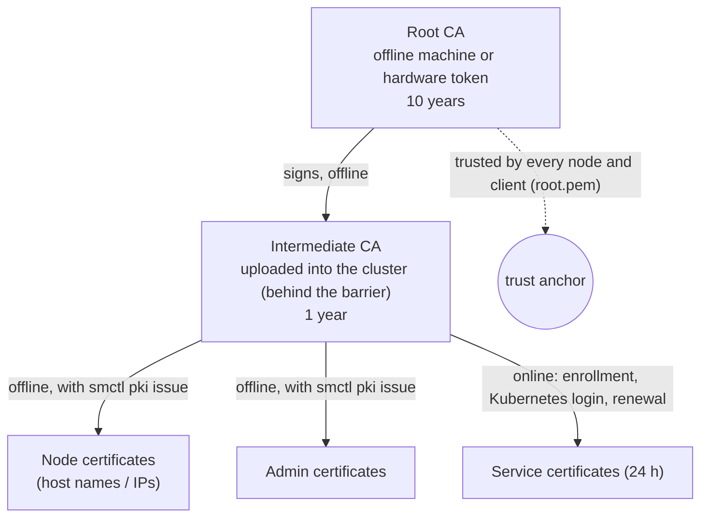

# Identities and PKI

There are no passwords and no API tokens. **Every caller is identified by a TLS client certificate** issued by the cluster's own certificate authority, and the identity is a single URI in that certificate.

## Identity format

| Kind | URI in the certificate | Used by | Maximum lifetime |
|---|---|---|---|
| Service | `spiffe://sm/svc/<name>` | applications (via `sm-agent`, the SDK or HTTPS) | 72 h. The cluster issues 24 h and they renew automatically. |
| Admin | `spiffe://sm/admin/<name>` | people using `smctl` | 30 days |
| Node | `spiffe://sm/node/<name>` | `smd` servers | 1 year |

- `<name>` is 1–63 characters of `a-z`, `0-9` and `-`.
- The URIs follow the [SPIFFE](https://spiffe.io) ID format with trust domain `sm`, so they're familiar to service-mesh tooling. No SPIFFE software is required.
- All keys are **ECDSA P-256**, and all connections use **TLS 1.3**.
- In policies, bindings, revocations and the audit log, identities appear as `svc/orders-api` or in full as `spiffe://sm/svc/orders-api`.

## CA hierarchy



Create it on an offline machine:

```bash
smctl pki root-init -out ca/                          # ca/root.pem, ca/root.key (keep offline)
smctl pki intermediate -ca-cert ca/root.pem -ca-key ca/root.key -out ca/
                                                      # ca/intermediate.pem, ca/intermediate.key
smctl pki issue -ca-cert ca/intermediate.pem -ca-key ca/intermediate.key \
      -kind node -name node-1 -host 10.0.0.1 -host sm-1.internal -ttl 8760h -out certs/
smctl pki issue -ca-cert ca/intermediate.pem -ca-key ca/intermediate.key \
      -kind admin -name alice -ttl 720h -out certs/
```

!!! warning "Always pass `-ttl` for nodes and admins"
    Without `-ttl`, `smctl pki issue` issues a **24-hour** certificate for every kind. Longer values are capped at the kind's maximum (nodes 1 year, admins 30 days, services 72 h).

Then let the cluster issue service certificates itself:

```bash
smctl pki upload -cert ca/intermediate.pem -key ca/intermediate.key
```

The cluster refuses an intermediate that isn't a CA, doesn't match its key, or doesn't chain to the root the nodes were started with.

## How services get certificates

A service never receives a key from the cluster. It generates its own key pair and sends a **certificate signing request (CSR)**. The cluster decides the identity; anything else the CSR asks for is ignored.

=== "Enrollment token (VMs, Docker, bare metal)"

    ```mermaid
    sequenceDiagram
        actor Admin
        participant SM as Cluster
        participant Agent as sm-agent
        Admin->>SM: POST /v1/sys/enroll-tokens {"service":"orders-api"}
        SM-->>Admin: smt_… (stored only as SHA-256; single use; 15 min default, 1 h max)
        Admin-->>Agent: deliver token (config management, cloud-init, a person)
        Agent->>SM: POST /v1/auth/enroll {token, csr}
        SM->>SM: mark token used (check-and-set: exactly one caller wins)
        SM-->>Agent: 24 h certificate for svc/orders-api
    ```

    Creating a token needs `create` on `sys/enroll-tokens/<service>`, so a team can be allowed to enroll its own services and nobody else's.

=== "Kubernetes service account"

    ```mermaid
    sequenceDiagram
        participant Pod as Pod (sm-agent)
        participant SM as Cluster
        participant K8s as Your Kubernetes API
        Pod->>SM: POST /v1/auth/kubernetes {jwt (projected, audience "sm"), csr}
        SM->>K8s: TokenReview (with the reviewer token)
        K8s-->>SM: authenticated as system:serviceaccount:shop:orders, audience sm
        SM->>SM: roles map: shop/orders → orders-api
        SM-->>Pod: 24 h certificate for svc/orders-api
    ```

    No token to hand out. The pod's projected service-account token proves who it is. See [Kubernetes](../guides/kubernetes.md).

## Renewal and the login lineage

`sm-agent` renews at **2/3 of the certificate's lifetime** by presenting its current certificate (`POST /v1/auth/renew`). A renewal is a new certificate with a new key and serial.

Each certificate carries the time of the **last full login** (enrollment or Kubernetes) in a private extension, and renewals carry it forward unchanged. That gives two protections:

- **A renewal cut-off.** Renewal is refused once the last full login is older than `-max-cert-lineage` (default **30 days**). A stolen certificate can't renew itself forever, because the service must log in again. Under Kubernetes auth the agent does that automatically; with tokens, you enroll it again.
- **Lineage revocation.** A certificate and every renewal descended from the same login share an identity and login time, so they can all be revoked at once, including copies a thief already renewed. See [Revoke access](../guides/revocation.md).

## Revocation

The API checks every authenticated request against a revocation list (`sys/revocations`) before policies are consulted:

| Revoke | Command | Effect |
|---|---|---|
| A certificate and all its renewals | `smctl cert revoke -cert leaked.pem` | Refused, along with every certificate from the same login |
| One certificate only | `smctl cert revoke -serial 1f3a…` | Refused. Renewals made from it are **not** covered. |
| A whole identity | `smctl cert revoke -identity svc/orders-api` | Every certificate for that name is refused, and no new ones are issued |

The root admin can't be revoked while it is root; see [Shares, rekey and root admin](../guides/key-ceremonies.md#hand-root-admin-to-someone-else).

!!! info "Nodes are removed, not revoked"
    The cluster's own Raft and RPC traffic doesn't consult the revocation list. To shut out a compromised node, remove it with `smctl operator remove-node`, which bans its node ID for good.
