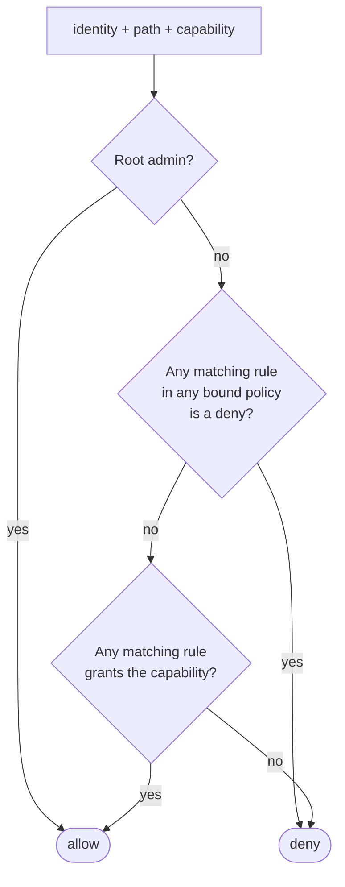

# Policies

Access control is **deny by default**. An identity can do something only if a policy bound to it allows it, and nothing denies it.

## Policies and bindings

A **policy** is a named list of rules. A **binding** attaches policies to an identity.

```json title="orders.json"
{
  "name": "orders",
  "rules": [
    { "path": "kv/prod/orders/*", "capabilities": ["read", "list"] },
    { "path": "kv/prod/orders/admin-only", "deny": true },
    { "path": "db/creds/orders-rw", "capabilities": ["read"] }
  ]
}
```

```bash
smctl policy write orders orders.json               # the name must match the file's "name"
smctl identity bind svc/orders-api orders           # comma-separate several: orders,shared-config
smctl identity show svc/orders-api
smctl identity unbind svc/orders-api                # removes all policies from the identity
```

Changes take effect **on the next request**. Policies and bindings aren't cached.

## How a decision is made



- **Deny wins.** A matching `"deny": true` rule blocks everything on that path, whatever other rules or policies say.
- **No ordering, no specificity.** Rules aren't evaluated top to bottom, and a more specific rule doesn't override a broader one. To carve out an exception, add a deny rule.
- **Unknown fields are rejected** when a policy is written, so a typo like `"capabilites"` fails loudly instead of silently granting nothing.
- A binding that names a policy that doesn't exist grants nothing for that name.

## Path patterns

Patterns are matched **segment by segment**, case-sensitively:

| Pattern | Matches | Doesn't match |
|---|---|---|
| `kv/prod/orders/db` | exactly `kv/prod/orders/db` | `kv/prod/orders/db2` |
| `kv/prod/+/db` | `kv/prod/orders/db`, `kv/prod/billing/db` | `kv/prod/a/b/db` |
| `kv/prod/orders/*` | `kv/prod/orders/db`, `kv/prod/orders/a/b` | `kv/prod/orders` itself |

- `+` matches exactly one segment and can appear anywhere.
- `*` matches one or more remaining segments, and only as the last segment.
- Wildcards must be whole segments: `kv/prod/orders-*` is rejected.

## Capabilities

| Capability | Allows |
|---|---|
| `read` | Reading a secret, metadata, settings; getting dynamic credentials (`db/creds/<role>`) |
| `list` | Listing keys under a path (`kv list`, lease listing) |
| `create` | Writing a path that **doesn't exist yet** (not even soft-deleted) |
| `update` | Writing a path that exists; operational actions (`sys/seal`, `sys/rotate`, …) |
| `delete` | Deleting and destroying |
| `rotate` | Reserved: accepted in policies, but no endpoint requires it yet |

`create` is separate from `update`. For example, a CI job can be allowed to *drop off* new secrets without being able to overwrite existing ones. The check is repeated at write time, so a race can't turn a create into an overwrite.

## What paths exist

Every API operation maps to a policy path. The main ones:

| Area | Policy path | Capabilities used |
|---|---|---|
| Secrets | `kv/<path>` | `read`, `list`, `create`, `update`, `delete` |
| Dynamic DB credentials | `db/creds/<role>` | `read` |
| DB roles (config) | `sys/db-roles/<role>` | `read`, `update`, `delete` |
| Leases (admin view) | `sys/leases/<prefix>` | `list`, `update` (revoke-prefix) |
| Rotation settings | `sys/rotation/<kv path>` | `read`, `update`, `delete` |
| Policies | `sys/policies/<name>` | `read`, `update`, `delete`; `list` on `sys/policies` |
| Bindings | `sys/bindings/<kind>/<name>` | `read`, `update`, `delete` |
| Enrollment tokens | `sys/enroll-tokens/<service>` | `create` |
| Kubernetes auth config | `sys/auth/kubernetes` | `update` |
| Intermediate CA upload | `sys/pki/intermediate` | `update` |
| Revocation list | `sys/revocations` | `read`, `update`, `delete` |
| Seal, rotate, rekey | `sys/seal`, `sys/rotate`, `sys/rekey` | `update` |
| Cluster membership | `sys/cluster` | `read`, `update` |
| Snapshots | `sys/snapshot` | `read` |
| Metrics | `sys/metrics` | `read` |
| Root admin (view) | `sys/root-admin` | `read` |

The [HTTP API reference](../reference/http-api.md) lists the exact path and capability for every endpoint.

!!! note "Settings that reference secrets need read on them"
    Rotation settings and database roles name an `admin` secret (the database admin connection string). Writing them also requires `read` on that `kv/` path, so being allowed to configure rotation doesn't mean being able to read any secret.

## The root admin

The admin who runs `init` becomes the **root admin**. It has unrestricted access regardless of policies, so it can bootstrap everything else.

- It can't be revoked while it is root.
- **A threshold of share holders can hand root to another admin** (`smctl operator root-admin`), after which the old one is an ordinary admin and can be revoked. A stolen root certificate alone can neither keep root nor take it back.
- Some operations don't use policies at all and require an **admin certificate**: `init`, `unseal`, restoring a snapshot into an empty cluster, and the root-admin handover (which also requires shares).

## Recipes

=== "Read-only service"

    ```json
    { "name": "orders-read", "rules": [
        { "path": "kv/prod/orders/*", "capabilities": ["read"] } ] }
    ```

=== "Team admin for its own area"

    ```json
    { "name": "orders-team", "rules": [
        { "path": "kv/prod/orders/*", "capabilities": ["read", "list", "create", "update", "delete"] },
        { "path": "sys/rotation/prod/orders/*", "capabilities": ["read", "update", "delete"] },
        { "path": "sys/enroll-tokens/orders-api", "capabilities": ["create"] },
        { "path": "sys/enroll-tokens/orders-worker", "capabilities": ["create"] } ] }
    ```

=== "CI drop-box (write new, never overwrite)"

    ```json
    { "name": "ci-dropbox", "rules": [
        { "path": "kv/ci/incoming/*", "capabilities": ["create"] } ] }
    ```

=== "Monitoring"

    ```json
    { "name": "prometheus", "rules": [
        { "path": "sys/metrics", "capabilities": ["read"] } ] }
    ```

=== "On-call operator"

    ```json
    { "name": "oncall", "rules": [
        { "path": "sys/seal", "capabilities": ["update"] },
        { "path": "sys/cluster", "capabilities": ["read", "update"] },
        { "path": "sys/snapshot", "capabilities": ["read"] },
        { "path": "sys/revocations", "capabilities": ["read", "update"] },
        { "path": "sys/leases/*", "capabilities": ["list", "update"] },
        { "path": "kv/*", "deny": true } ] }
    ```

See the [policy language reference](../reference/policy-language.md) for the exact grammar.
