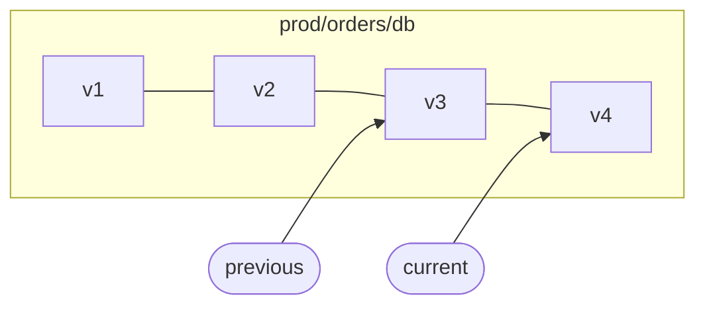

# Secrets and versions

Secrets are stored as **versioned key/value entries**. A secret's path, e.g. `prod/orders/db`, is its key, and its policy path is `kv/prod/orders/db`.

## Paths

A path is one or more segments separated by `/`, where each segment is made of `A–Z a–z 0–9 . _ -`. Empty segments, `.` and `..` are rejected, as are leading and trailing slashes.

```text
prod/orders/db          ✔
prod/orders/db.url      ✔
/prod/orders            ✘ leading slash
prod//orders            ✘ empty segment
prod/../billing         ✘ dot-dot
prod/orders/my key      ✘ space
```

!!! note
    Paths are stored unencrypted (values are encrypted). Don't put anything sensitive in a path.

## Versions and labels

Every write creates a new version, numbered from 1. Up to **10 versions** are kept; the oldest unlabelled ones are dropped first. Labels point at versions:

| Label | Points at |
|---|---|
| `current` | the version served by default, set on every write |
| `previous` | the version that was `current` before the last change |
| `pending` | a rotation's new value, written but not yet tested (see [Rotate secrets](../guides/rotation.md)) |



```bash
smctl kv get prod/orders/db                      # current (value hidden)
smctl kv get -reveal prod/orders/db              # current value
smctl kv get -reveal -version 1 prod/orders/db   # a specific version
smctl kv get -reveal -label previous prod/orders/db
smctl kv history prod/orders/db                  # versions and labels, no values
```

Keeping `previous` makes rollbacks and zero-downtime rotations possible. An application that briefly holds the old value doesn't break.

## Check-and-set

Concurrent writers can protect against overwriting each other with `cas`:

| `cas` | Meaning |
|---|---|
| *(absent)* | no check: always write a new version |
| `0` | only if the secret doesn't exist (a soft-deleted one counts as not existing, and is revived) |
| `N` | only if the latest version is exactly `N` |

```bash
printf 'v5' | smctl kv put -cas 4 prod/orders/db   # fails with 409 if someone else wrote v5 first
```

Every change inside the cluster is itself a check-and-set read-modify-write, so writers on different nodes never lose each other's updates.

## Create versus update

Writing a path that doesn't exist needs the `create` capability, and writing one that does needs `update`. **A soft-deleted secret still exists**: writing it would revive its old versions, so that needs `update`. A caller with only `create` can therefore never overwrite or resurrect anything, even in a race.

## Delete, undelete, destroy

| Command | Effect | Reversible |
|---|---|---|
| `smctl kv delete <path>` | soft delete: hidden from reads, versions kept | yes, for **7 days** |
| `smctl kv undelete <path>` | brings a soft-deleted secret back | |
| `smctl kv destroy <path>` | removes the secret and all its versions immediately | **no** |

Soft-deleted secrets past their recovery window are purged the next time they're accessed. `kv list` still shows soft-deleted secrets, and `kv history` shows their `deleted_at`, so you can see what can be recovered.

## Listing

```console
$ smctl kv list prod
{
  "keys": ["prod/orders/api-key", "prod/orders/db"]
}
```

Listing returns every path under the prefix, at any depth, and needs `list` on the prefix's policy path (`kv/prod`). Listing everything (`smctl kv list` with no prefix) needs `list` on `kv`.

## Values

A value is arbitrary bytes, up to about 1 MiB per request. `kv put` reads it from stdin exactly, so files with trailing newlines survive:

```bash
smctl kv put prod/tls/key < server.key
smctl kv get -reveal prod/tls/key > server.key
```

Structured secrets are just values. The SQL rotation plugins, for example, store `{"username": "...", "password": "..."}` JSON.
