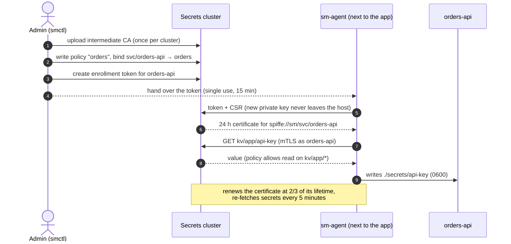

# Your first application

In this tutorial, a service called **orders-api** gets its own identity, a policy that lets it read only its own secrets, and a certificate it keeps renewed. It then reads a secret in three different ways. Everything runs against the [quick start](quickstart.md) cluster.



Keep the environment from the quick start (`SM_ADDR`, `SM_CA`, `SM_CERT`, `SM_KEY` and `PATH`).

## 1. Let the cluster issue service certificates

Services get certificates from the cluster itself, signed by an **intermediate CA** you upload once. The root CA stays offline.

```console
$ smctl pki upload -cert try/ca/intermediate.pem -key try/ca/intermediate.key
```

The cluster checks that the intermediate chains to the root the nodes trust, then stores it behind the barrier (encrypted).

## 2. Store a secret for the app

```bash
printf 'k-123' | smctl kv put app/api-key
```

## 3. Write a policy and bind the identity

A policy grants capabilities on path patterns. Secrets live under `kv/`, so `kv/app/*` means "everything under `app/`":

```json title="orders.json"
{
  "name": "orders",
  "rules": [
    { "path": "kv/app/*", "capabilities": ["read"] }
  ]
}
```

```bash
smctl policy write orders orders.json
smctl identity bind svc/orders-api orders
```

```console
$ smctl identity show svc/orders-api
{
  "policies": ["orders"]
}
```

Nothing is allowed unless a policy says so. See [Policies](../concepts/policies.md).

## 4. Create an enrollment token

```bash
smctl enroll token -service orders-api | sed -n 's/.*"token": "\(.*\)".*/\1/p' > token.txt
```

`enroll token` prints JSON like this:

```json
{
  "expires": "2026-09-24T10:14:50Z",
  "service": "orders-api",
  "token": "smt_ZrC83-vHxNneWunpqjHXpk6frmx8LoSPJmIib-Q-kxg"
}
```

The token works **once**, for **15 minutes** by default (`-ttl` up to 1 h), and only for `orders-api`. The cluster stores only its SHA-256 hash.

## 5. Run sm-agent

```bash
sm-agent -auth token -token-file token.txt -out ./secrets \
         -secret app/api-key=api-key
```

The agent logs in, writes its files, and keeps running: it renews the certificate and re-fetches secrets every 5 minutes. Add `-once` to log in, write the files and exit.

```console
$ ls ./secrets
api-key  ca.crt  tls.crt  tls.key
$ cat ./secrets/api-key
k-123
```

| File | Contents |
|---|---|
| `api-key` | the secret, named by `-secret path=file` (mode 0600, replaced atomically when the version changes) |
| `tls.crt` | the service certificate followed by the intermediate |
| `tls.key` | its private key, generated on this host |
| `ca.crt` | the root CA, to verify the cluster |

!!! tip
    In production, point `-out` at a memory-backed directory (tmpfs, or a Kubernetes `emptyDir` with `medium: Memory`), so secrets never reach disk.

## 6. Read the secret from your app

=== "Files (any language)"

    Read the file. That's the whole integration:

    ```python
    api_key = open("./secrets/api-key").read()
    ```

    Re-read it when it changes (watch the file, or read it on each use). The agent updates it after a rotation.

=== "Python SDK"

    ```python
    from smclient import Client

    sm = Client.from_agent_dir(["127.0.0.1:8210", "127.0.0.1:8220", "127.0.0.1:8230"], "./secrets")

    api_key = sm.get("app/api-key")        # SecretStr: prints as '**********'
    print(api_key.reveal())                # k-123

    sm.on_rotate("app/api-key", lambda s: print("new version", s.version))
    ```

    The SDK uses the agent's certificate, caches values (5 minutes by default), refreshes them in the background, and keeps serving the last value for up to an hour if every node is unreachable. See [Python SDK](../components/python-sdk.md).

=== "HTTPS (any language)"

    ```bash
    curl --cert secrets/tls.crt --key secrets/tls.key --cacert secrets/ca.crt \
         https://127.0.0.1:8210/v1/kv/app/api-key
    ```

    ```json
    {"path":"app/api-key","value":"k-123","version":1,"created":"2026-09-24T09:56:56.4503188Z"}
    ```

    Windows' built-in `curl` can't use PEM client certificates. Use another client there, or see [Other languages](../guides/other-languages.md).

## 7. Check the boundaries

The policy only allows reads under `app/`:

```python
>>> sm.get("prod/other-team/key")
smclient.PermissionDenied: 403: permission denied
```

The answer is the same `403` whether or not the path exists, so callers can't probe for secret names. Each attempt is in the audit log, and a burst of them sets off Sentinel's `denial_burst` alert.

## What just happened

- **The identity is the certificate.** The cluster never saw a password. `spiffe://sm/svc/orders-api` is written into the certificate it issued, and every request is checked against it.
- **The private key was generated next to the app** and never sent anywhere. The cluster signed a certificate request (CSR).
- **Least privilege by default.** The service can read `kv/app/*` and nothing else.
- **Everything is audited**, including the enrollment, the token use, and each read.

## Next steps

- Run it on Kubernetes without tokens: [Kubernetes](../guides/kubernetes.md)
- Rotate the secret automatically: [Rotate secrets](../guides/rotation.md)
- Give each pod its own database user: [Dynamic database credentials](../guides/dynamic-credentials.md)
- Understand the pieces: [Concepts](../concepts/index.md)
