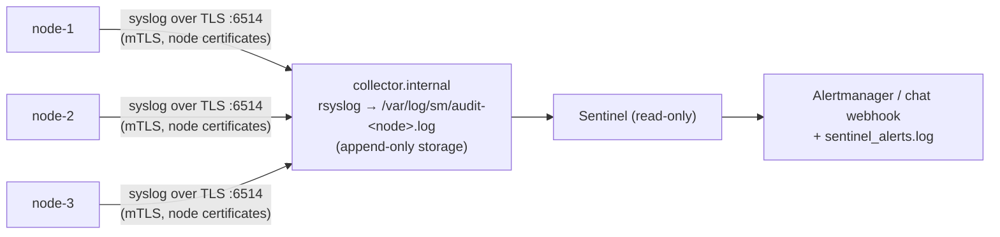

# Audit forwarding and alerts

A node's local audit log can't protect against someone with root on that node: they could rewrite it. Forward every node's log to a **collector** the nodes can only append to, and run **Sentinel** there.



## 1. A certificate for the collector

The nodes verify the collector's certificate. Give the collector its **own small CA**, so its certificate is not trusted by the cluster itself:

```bash
# on the offline machine
smctl pki root-init -out collector-ca/
smctl pki issue -ca-cert collector-ca/root.pem -ca-key collector-ca/root.key \
      -kind node -name collector -host collector.internal -ttl 8760h -out collector-certs/
```

- The collector gets `collector-certs/collector.pem` and `.key`, plus the **cluster's** `root.pem`, which it uses to verify the nodes.
- Each node gets `collector-ca/root.pem` as its `-audit-forward-ca`.

## 2. The collector (rsyslog)

!!! note
    The configuration below is a starting point. Test it against your rsyslog version (it needs the `gtls` driver package, e.g. `rsyslog-gnutls`).

```text title="/etc/rsyslog.d/10-secrets-manager.conf"
global(
  DefaultNetstreamDriver="gtls"
  # The cluster's root CA: verifies the nodes' client certificates.
  DefaultNetstreamDriverCAFile="/etc/rsyslog.d/sm/cluster-root.pem"
  DefaultNetstreamDriverCertFile="/etc/rsyslog.d/sm/collector.pem"
  DefaultNetstreamDriverKeyFile="/etc/rsyslog.d/sm/collector.key"
)

module(load="imtcp"
       StreamDriver.Name="gtls"
       StreamDriver.Mode="1"
       StreamDriver.AuthMode="x509/name"
       PermittedPeer=["sm-1.internal", "sm-2.internal", "sm-3.internal"])

input(type="imtcp" port="6514" ruleset="secrets-manager")

template(name="smFile" type="string" string="/var/log/sm/audit-%HOSTNAME%.log")
template(name="smLine" type="string" string="%rawmsg%\n")

ruleset(name="secrets-manager") {
  action(type="omfile" dynaFile="smFile" template="smLine" dirCreateMode="0750" fileCreateMode="0640")
}
```

- **TLS only, client certificate required.** `StreamDriver.Mode="1"` enforces TLS, and `x509/name` checks the client's certificate against `PermittedPeer`.
- **Only nodes are accepted.** `PermittedPeer` lists the nodes' DNS names, which are in their certificates. Service and admin certificates carry no DNS names, so they're refused.
- **One file per node.** Each message's HOSTNAME is the node ID, so each node gets its own file.
- **Append-only storage.** Make `/var/log/sm` append-only (for example `chattr +a` on the files) or ship it on to write-once storage. The nodes must have no other way to reach it.

Each line in those files looks like:

```text
<110>1 2026-09-24T11:50:24.763Z node-1 smd - - - {"seq":81,"time":"2026-09-24T11:50:24.7633959Z",…,"hash":"3ed2f611…"}
```

## 3. The nodes

Add to every `smd`:

```bash
-audit-forward collector.internal:6514 -audit-forward-ca /etc/smd/collector-ca.pem
```

How forwarding behaves:

- **The node authenticates with its node certificate** (mutual TLS).
- **The local `audit.log` is the buffer.** `audit.log.forwarded` records how far delivery got, so if the collector is down, lines are sent when it's back.
- **Requests fail** if more than `-audit-forward-max-lag` bytes (default 64 MiB) are waiting. Nothing goes unrecorded off-host for long. Watch `sm_audit_forward_lag_bytes`.
- **Forwarding stops, and requests fail,** if the local log is ever shorter than what was already sent (truncated or replaced). Investigate, then delete `audit.log.forwarded` to re-send everything.

!!! info "Delivery guarantees"
    Syslog has no acknowledgements. A line counts as delivered once it's been written and the collector hasn't dropped the connection for a moment afterwards, and anything uncertain is re-sent. A collector that loses power mid-stream can still lose lines in flight; the node's local file keeps everything.

## 4. Verify the chains

On the collector, verify each node's copy, and use the last record it holds to catch truncation of a node's local log:

```bash
tail -1 /var/log/sm/audit-node-1.log | sed 's/^[^{]*//' | python3 -c 'import json,sys; r=json.load(sys.stdin); print(str(r["seq"]) + ":" + r["hash"])'
# 81:3ed2f611d8faf496c88e30db8998210786bbcf4cab8d038c279c5608f5ea187f

# on node-1 (or a copy of its local log):
smctl audit verify -head 81:3ed2f611d8faf496c88e30db8998210786bbcf4cab8d038c279c5608f5ea187f /var/lib/smd/audit.log
```

## 5. Sentinel

```bash
pip install ./sentinel
cp sentinel/sentinel.example.json /etc/sentinel.json    # edit trusted_networks, admin_windows
```

```ini title="/etc/systemd/system/sentinel.service"
[Unit]
Description=Sentinel alerts for Secrets Manager
After=network-online.target

[Service]
# The sentinel user needs read-only access to /var/log/sm.
User=sentinel
ExecStart=/usr/bin/python3 -m sentinel watch --config /etc/sentinel.json \
  --state /var/lib/sentinel/state.json --alerts /var/log/sentinel_alerts.log \
  --webhook https://alertmanager.internal:9093/api/v2/alerts --webhook-format alertmanager \
  /var/log/sm/audit-node-1.log /var/log/sm/audit-node-2.log /var/log/sm/audit-node-3.log
StateDirectory=sentinel
Restart=on-failure

[Install]
WantedBy=multi-user.target
```

Before going live, replay your history to tune the thresholds:

```bash
python3 -m sentinel replay --config /etc/sentinel.json /var/log/sm/audit-*.log > /tmp/alerts.jsonl
```

What each alert means and what to do is in the [runbooks](../runbooks/README.md); the rules and settings are in [Sentinel](../components/sentinel.md).
