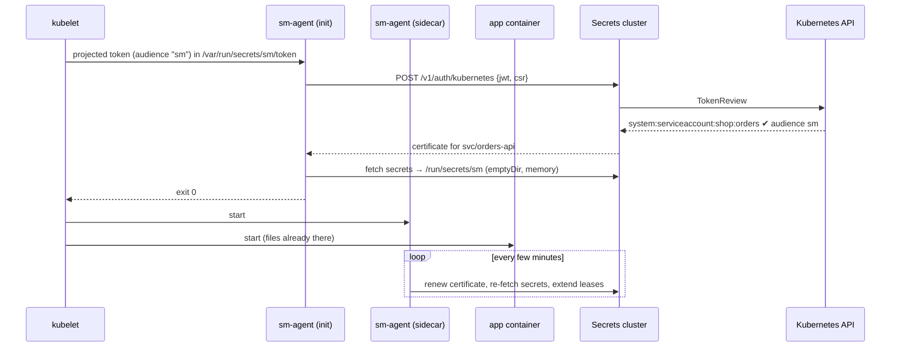

# Kubernetes

Pods prove who they are with their **service-account token**, so there's no token to hand out. The cluster checks the token with **your** Kubernetes API (TokenReview), maps the service account to a service name, and issues a certificate. `sm-agent` runs as an **init container** (secrets exist before the app starts) and a **sidecar** (keeps them fresh).



The complete manifest is in the repository: [`deploy/k8s/orders-api-example.yaml`](https://github.com/hamad-tariq/SecretsManager/blob/main/deploy/k8s/orders-api-example.yaml).

## 1. A reviewer identity in Kubernetes

The secrets cluster needs a token that is allowed to create TokenReviews. The built-in `system:auth-delegator` role allows exactly that:

```yaml
apiVersion: v1
kind: Namespace
metadata: { name: sm-system }
---
apiVersion: v1
kind: ServiceAccount
metadata: { name: sm-reviewer, namespace: sm-system }
---
apiVersion: rbac.authorization.k8s.io/v1
kind: ClusterRoleBinding
metadata: { name: sm-reviewer-tokenreview }
roleRef: { apiGroup: rbac.authorization.k8s.io, kind: ClusterRole, name: system:auth-delegator }
subjects: [{ kind: ServiceAccount, name: sm-reviewer, namespace: sm-system }]
---
apiVersion: v1
kind: Secret
metadata:
  name: sm-reviewer-token
  namespace: sm-system
  annotations: { kubernetes.io/service-account.name: sm-reviewer }
type: kubernetes.io/service-account-token
```

## 2. Configure Kubernetes login on the secrets cluster

```bash
kubectl -n sm-system get secret sm-reviewer-token -o jsonpath='{.data.token}' | base64 -d > reviewer.token
kubectl config view --raw --minify -o jsonpath='{.clusters[0].cluster.certificate-authority-data}' | base64 -d > k8s-ca.crt

smctl auth kubernetes -host https://k8s-api.internal:6443 -ca-file k8s-ca.crt \
      -reviewer-token-file reviewer.token -audience sm \
      -role shop/orders=orders-api \
      -role shop/billing=billing-api
rm reviewer.token
```

| Flag | Meaning |
|---|---|
| `-host` | Your Kubernetes API server (HTTPS). |
| `-ca-file` | Its CA certificate. The system trust store is never used. |
| `-reviewer-token-file` | The token from step 1. It's stored behind the barrier. |
| `-audience` | The audience pods' projected tokens must carry (default `sm`). Tokens for other audiences, like the default API token, are refused. |
| `-role ns/sa=service` | Maps a namespace/service account to a service name. Repeat it for each. Unmapped service accounts can't log in. |

Then write and bind the services' policies as usual (`smctl identity bind svc/orders-api orders`).

## 3. The pod

The essential parts:

```yaml
spec:
  serviceAccountName: orders
  securityContext:
    runAsNonRoot: true
    runAsUser: 10001          # agent and app share a UID, so the 0600 files are readable by both
    runAsGroup: 10001
  volumes:
    - name: sm-secrets
      emptyDir: { medium: Memory, sizeLimit: 1Mi }    # never written to disk
    - name: sm-token
      projected:
        sources:
          - serviceAccountToken: { audience: sm, expirationSeconds: 3600, path: token }
    - name: sm-ca
      configMap: { name: sm-ca }                       # root.pem as ca.crt
  initContainers:
    - name: sm-agent-init
      image: registry.internal/sm-agent:0.1.0
      args:
        - -addr=sm-1.sm.internal:8200,sm-2.sm.internal:8200,sm-3.sm.internal:8200
        - -ca=/etc/sm/ca.crt
        - -out=/run/secrets/sm
        - -auth=kubernetes
        - -jwt-file=/var/run/secrets/sm/token
        - -secret=prod/orders/db=db-password
        - -once
      volumeMounts:
        - { name: sm-secrets, mountPath: /run/secrets/sm }
        - { name: sm-token, mountPath: /var/run/secrets/sm, readOnly: true }
        - { name: sm-ca, mountPath: /etc/sm, readOnly: true }
  containers:
    - name: sm-agent            # same args without -once, plus -refresh=5m
      …
    - name: app
      image: registry.internal/orders-api:1.0.0
      env:
        - { name: SM_ADDR, value: "sm-1.sm.internal:8200,sm-2.sm.internal:8200,sm-3.sm.internal:8200" }
        - { name: SM_AGENT_DIR, value: /run/secrets/sm }
      volumeMounts:
        - { name: sm-secrets, mountPath: /run/secrets/sm, readOnly: true }
```

The app reads `/run/secrets/sm/db-password`, or uses the SDK:

```python
import os
from smclient import Client
sm = Client.from_agent_dir(os.environ["SM_ADDR"].split(","), os.environ["SM_AGENT_DIR"])
```

!!! tip "Hardening that the example already does"
    - `automountServiceAccountToken: false` on the service account: the pod gets **only** the audience-bound token, not the general API token.
    - `readOnlyRootFilesystem`, `drop: [ALL]` and `allowPrivilegeEscalation: false` on every container.
    - Memory limits of 32 MiB on the agent containers.

## Per-pod database users on Kubernetes

Add `-db orders-rw=db.json` to the **sidecar** (not the init container, since nobody would renew the lease). Each pod then gets its own database user, dropped some time after the pod goes away. See [Dynamic database credentials](dynamic-credentials.md).

## Troubleshooting

| Symptom | Likely cause |
|---|---|
| `401 authentication failed` from `/v1/auth/kubernetes` | Service account not in the `-role` map; wrong audience; reviewer token revoked or missing `system:auth-delegator`. The `smd` log says which (`kubernetes login rejected`). |
| `403 identity revoked` | The service identity is on the revocation list. |
| Init container can't connect | `-addr` names or ports unreachable from the pod network; the node certificates don't list the host names used in `-addr`. |
| App can't read the files | The app and agent run as different UIDs (the files are mode 0600). |
