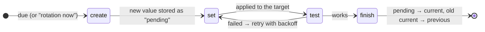
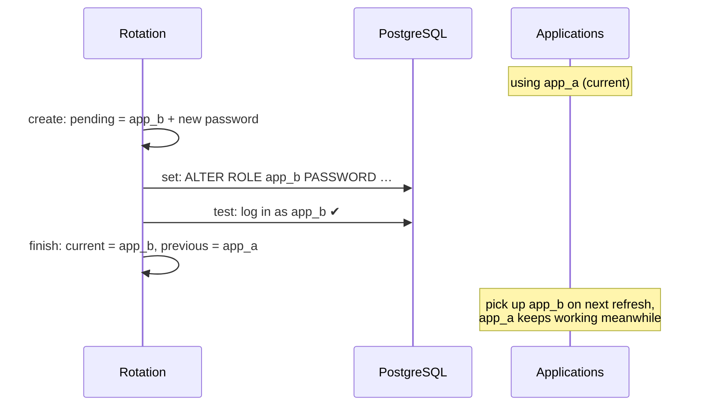

# Rotate secrets

Rotation replaces a secret's value on a schedule, **without downtime**: the new value is applied to its target and tested before anyone is served it.

## How a rotation runs



| Step | What happens | Example (PostgreSQL) |
|---|---|---|
| **create** | The plugin makes a new value, stored as a new version labelled `pending`. `current` is unchanged. | picks the user not in use, generates a password |
| **set** | The plugin applies it to the target. | `ALTER ROLE app_b WITH PASSWORD '<SCRAM verifier>'` |
| **test** | The plugin checks it works. | logs in as `app_b` with the new password |
| **finish** | `pending` becomes `current`, and the old `current` becomes `previous`. | |

- Progress is saved after **every** step. If the leader dies mid-rotation, the next leader resumes where it stopped.
- Every step is safe to repeat. A failed step is retried with **exponential backoff** (1 minute, doubling, up to 1 hour); a failed test goes back to *set*. `pending` is never promoted until its test passes.
- Only the Raft leader runs rotations. It checks for due work every `-rotation-check` (10 s).
- **The first rotation runs right after you configure it**, and then every `interval`.

## Plugins

=== "random"

    For values nothing else needs to know about: API keys you hand out, HMAC keys, session secrets.

    ```bash
    smctl rotation set -interval 720h -plugin random -param length=40 -param format=base64 prod/orders/api-key
    ```

    | Parameter | Default | Values |
    |---|---|---|
    | `length` | `32` | 16–1024 (random bytes for hex/base64; characters for alnum) |
    | `format` | `alnum` | `alnum`, `hex`, `base64` |

=== "postgres"

    Rotates a PostgreSQL user's password. The secret's value becomes `{"username": "...", "password": "..."}`.

    ```bash
    printf 'postgres://rotator:…@db.internal:5432/app' | smctl kv put db/admin
    smctl rotation set -interval 720h -plugin postgres \
          -param admin=db/admin -param users=app_a,app_b prod/orders/db
    ```

    | Parameter | Meaning |
    |---|---|
    | `admin` | kv path of the admin connection string (you need `read` on it to configure this) |
    | `users` | `app_a,app_b` (two alternating users, recommended) or one user |
    | `length` | password length, default 32 |

    The password is sent as a **SCRAM-SHA-256 verifier**, never in plaintext, so it can't leak through statement logging. The admin user needs the right to `ALTER ROLE` those users (e.g. `CREATEROLE`).

=== "mysql"

    Same as `postgres`, for MySQL (`ALTER USER … IDENTIFIED BY`, which MySQL masks in its logs).

    ```bash
    printf 'rotator:…@tcp(mysql.internal:3306)/' | smctl kv put db/mysql-admin
    smctl rotation set -interval 720h -plugin mysql \
          -param admin=db/mysql-admin -param users=app_a,app_b -param host=10.0.% prod/billing/db
    ```

    Extra parameter: `host`, the MySQL account host (default `%`).

=== "http"

    Your own service applies the value, for anything the built-in plugins don't cover.

    ```bash
    smctl rotation set -interval 168h -plugin http \
          -param url=https://billing-admin.internal:9443/rotate \
          -param identity=svc/billing-admin -param length=48 prod/billing/webhook-secret
    ```

    See [HTTP hook protocol](#http-hook-protocol) below.

## Zero downtime with two users

With **two alternating users**, each rotation changes the password of the user that is **not** currently in use, then switches:



Apps holding the previous credential keep working until the **next** rotation, one full interval later. With **one** user, clients fail from the *set* step until they fetch the new value, so use one user only for things that can tolerate that.

Both users need the same grants in the database. Create them once:

```sql
CREATE ROLE app_a LOGIN; CREATE ROLE app_b LOGIN;
GRANT app_rw TO app_a, app_b;          -- a role holding the actual privileges
```

## HTTP hook protocol

The leader calls your service over **mTLS**, presenting its node certificate:

```http
POST /rotate HTTP/1.1
Content-Type: application/json

{"step": "set", "path": "prod/billing/webhook-secret", "value": "Zq3…"}
```

- It's called with `"step": "set"` to apply the value and `"step": "test"` to check it works. Both must be safe to repeat.
- **Any 2xx** is success. Anything else, including a redirect (which is never followed), is a failure and is retried.
- Your service must present a certificate from this cluster's CA for **exactly** `params.identity` (e.g. `spiffe://sm/svc/billing-admin`) and not be revoked. Host names aren't checked; the identity is.
- Verify the caller: accept only certificates chaining to your root CA whose identity is a node (`spiffe://sm/node/...`).

A minimal receiver, in Python:

```python
import http.server, json, ssl

class Rotate(http.server.BaseHTTPRequestHandler):
    def do_POST(self):
        peer = self.connection.getpeercert()
        uris = [v for k, v in peer.get("subjectAltName", ()) if k == "URI"]
        if not any(u.startswith("spiffe://sm/node/") for u in uris):
            self.send_error(403); return
        body = json.loads(self.rfile.read(int(self.headers["Content-Length"])))
        if body["step"] == "set":
            apply_new_webhook_secret(body["value"])      # your code; must be idempotent
        elif body["step"] == "test":
            check_webhook_secret(body["value"])          # raise → 500 → retried
        self.send_response(204); self.end_headers()

ctx = ssl.SSLContext(ssl.PROTOCOL_TLS_SERVER)
ctx.minimum_version = ssl.TLSVersion.TLSv1_3
ctx.load_cert_chain("/run/secrets/sm/tls.crt", "/run/secrets/sm/tls.key")   # svc/billing-admin, via sm-agent
ctx.load_verify_locations("/run/secrets/sm/ca.crt")
ctx.verify_mode = ssl.CERT_REQUIRED
srv = http.server.HTTPServer(("0.0.0.0", 9443), Rotate)
srv.socket = ctx.wrap_socket(srv.socket, server_side=True)
srv.serve_forever()
```

## Watching and controlling rotations

```console
$ smctl rotation get prod/orders/api-key
{
  "interval": "720h",
  "last_rotated": "2026-09-24T11:50:19.4847106Z",
  "next_due": "2026-10-24T11:50:19.4847106Z",
  "params": { "format": "base64", "length": "40" },
  "plugin": "random"
}
```

While a rotation is in progress or failing, you'll also see `step` (the next step to run), `pending_version`, `attempts`, `next_attempt` and `last_error`. Error text is scrubbed of connection strings.

```bash
smctl rotation now prod/orders/api-key       # rotate at the next check, clearing any backoff
smctl rotation delete prod/orders/api-key    # stop rotating; the secret is kept
```

Metrics: `sm_rotations_total{path}` and `sm_rotation_failures_total{path,step}`. Alert on failures (see [Monitoring](monitoring.md)).

## Permissions

| Action | Needs |
|---|---|
| Configure rotation of `prod/orders/db` | `update` on `sys/rotation/prod/orders/db`, **and** `read` on `kv/<admin path>` for SQL plugins |
| View | `read` on `sys/rotation/<path>` |
| Trigger now | `update` on `sys/rotation/<path>` |
| Stop | `delete` on `sys/rotation/<path>` |

!!! warning "Rotation settings are powerful"
    Whoever can change `sys/rotation/<path>` can point an HTTP hook at another service identity, which then receives the new value. Grant it like write access to the secret itself.

## Applications picking up new values

- **Files:** `sm-agent` rewrites the file within its `-refresh` interval (default 5 minutes).
- **Python SDK:** `sm.on_rotate(path, callback)` fires when a background refresh sees the new version.
- **Your own client:** re-read on a timer, or when a connection fails with an authentication error. `previous` stays valid until the next rotation.
