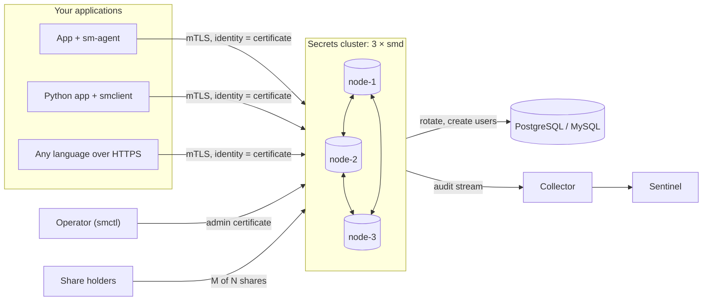

---
hide:
  - navigation
  - toc
---

# :material-shield-lock: Secrets Manager

A self-hosted secrets vault for your applications, dependent on no third-party service.

[Get started :material-arrow-right:](getting-started/index.md){ .md-button .md-button--primary }
[Try it in 2 minutes](getting-started/quickstart.md){ .md-button }
[View on GitHub :fontawesome-brands-github:](https://github.com/hamad-tariq/SecretsManager){ .md-button }

!!! warning "Experimental: not independently audited"
    Secrets Manager has had an internal security review (17 findings, all fixed) but **no external audit or penetration test**. Use it for learning, labs and non-critical systems, and don't use it for production secrets until someone other than its author has reviewed it. See the [threat model](threat-model.md) for what it protects against and its known gaps.

## What you get

-   :material-lock:{ .lg .middle } __Encrypted at rest__

    ---

    Every stored value is encrypted with XChaCha20-Poly1305 behind a *barrier*. Disks, Raft traffic and backups hold only ciphertext.

    [:octicons-arrow-right-24: Encryption and sealing](concepts/encryption-and-sealing.md)

-   :material-key-chain:{ .lg .middle } __Shamir unseal__

    ---

    The master key is split into N shares, any M of which unseal it. No single person or stolen server can open the vault.

    [:octicons-arrow-right-24: Shares, rekey and root admin](guides/key-ceremonies.md)

-   :material-card-account-details:{ .lg .middle } __Certificate identities__

    ---

    Services, admins and nodes authenticate with certificates from the built-in CA. There are no passwords or static tokens, and service certificates renew themselves.

    [:octicons-arrow-right-24: Identities and PKI](concepts/identities.md)

-   :material-file-lock:{ .lg .middle } __Deny-by-default policies__

    ---

    Path patterns, with capabilities `read`, `list`, `create`, `update` and `delete`. An explicit deny always wins.

    [:octicons-arrow-right-24: Policies](concepts/policies.md)

-   :material-autorenew:{ .lg .middle } __Zero-downtime rotation__

    ---

    Rotates random values and PostgreSQL/MySQL passwords on a schedule in four safe steps, or hands the value to your own service through an HTTP hook.

    [:octicons-arrow-right-24: Rotate secrets](guides/rotation.md)

-   :material-database-clock:{ .lg .middle } __Dynamic database users__

    ---

    One short-lived database user per app instance. When the lease ends, its sessions are killed and the user is dropped.

    [:octicons-arrow-right-24: Dynamic credentials](guides/dynamic-credentials.md)

-   :material-kubernetes:{ .lg .middle } __Kubernetes-native__

    ---

    Pods log in with their service account. `sm-agent` runs as an init container or sidecar and writes secrets to memory-backed files.

    [:octicons-arrow-right-24: Kubernetes guide](guides/kubernetes.md)

-   :material-file-document-check:{ .lg .middle } __Tamper-evident audit__

    ---

    A hash-chained log of every request, forwarded off-host and verifiable offline. The API refuses to serve when it can't log.

    [:octicons-arrow-right-24: Audit log](concepts/audit.md)

-   :material-alarm-light:{ .lg .middle } __Built-in misuse alerts__

    ---

    Sentinel flags stolen certificates, bulk reads, probing, rate spikes, off-hours admin use and log tampering.

    [:octicons-arrow-right-24: Sentinel](components/sentinel.md)

## How it fits together

## Pick your path

| I want to… | Start here |
|---|---|
| See it working on my laptop | [Quick start](getting-started/quickstart.md) |
| Connect my application to it | [Your first application](getting-started/first-app.md) |
| Understand how it keeps secrets safe | [Concepts](concepts/index.md) |
| Run it for real on three servers | [Deploy a production cluster](guides/deploy-cluster.md) |
| Use it from Kubernetes | [Kubernetes](guides/kubernetes.md) |
| Look up a command, endpoint or flag | [Reference](reference/index.md) |
| Handle an incident | [Runbooks](runbooks/README.md) |

## Principles

- **Nothing outside your infrastructure.** No cloud KMS, hosted service, external database or identity provider, and no telemetry.
- **Vetted cryptography only.** It uses Go's standard library and `golang.org/x/crypto`, with no home-made algorithms.
- **Fail closed.** A request is denied when the node is sealed, the audit log can't be written, the caller is revoked, or no policy allows it.
- **Small enough to read.** About 9,000 lines of Go. Every design decision is written down in the [implementation plan](https://github.com/hamad-tariq/SecretsManager/blob/main/IMPLEMENTATION_PLAN.md).

---

<small>Secrets Manager is an independent open-source project by [Hammad Tariq](https://thehammadtariq.com), licensed under [Apache-2.0](project/license.md). It is not affiliated with AWS Secrets Manager, HashiCorp or any other vendor.</small>
